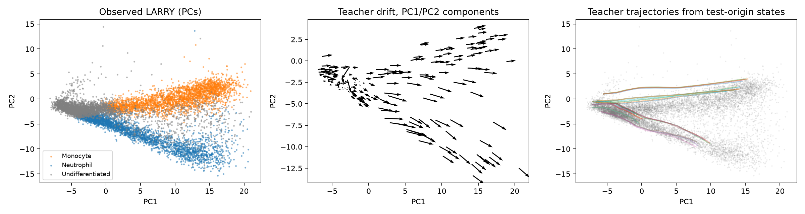
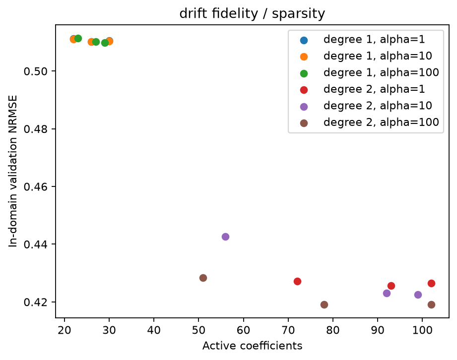
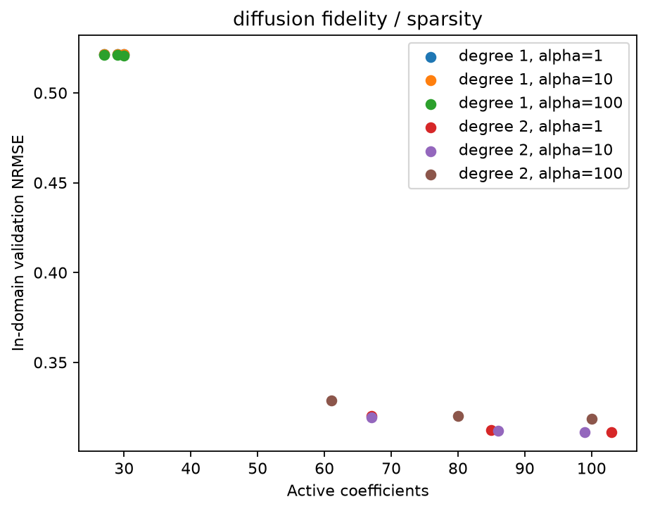
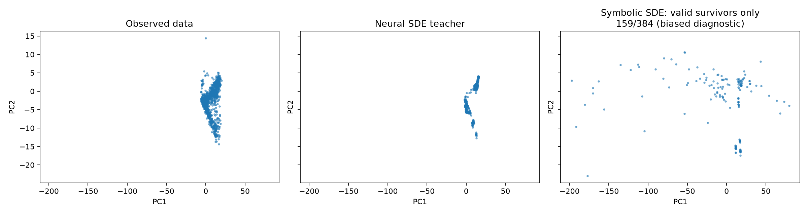
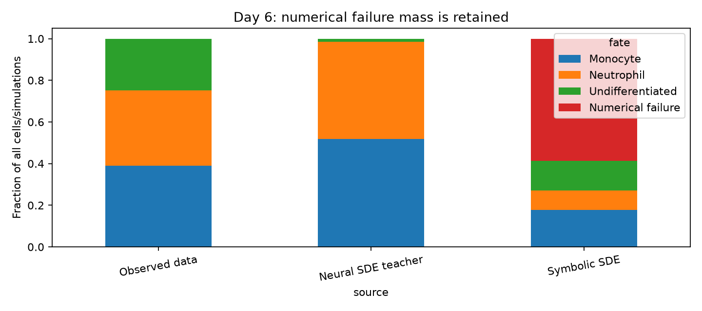

# Neural SDE の多項式 SINDy 蒸留 — LARRY 造血分化データでの検証

2026-10-07 実施 / 研究レポート

> **要旨.** LARRY in vitro 造血分化データで scDiffEq の Neural SDE を学習し、その drift $f_\theta$ と
> diffusion 係数 $G_\theta$ を、定数・べき・交差項だけからなる多項式で SINDy (STLSQ) 蒸留した。
> 50 次元 PCA の teacher では drift の近似が事前基準を満たさなかった。そこで別途学習した 5 次元 PCA の teacher では、
> 2 次多項式で drift (validation NRMSE 0.43, 51 係数) と $G$ (同 0.33, 61 係数) が局所的に近似できた。
> しかし得られた symbolic SDE を day 2 → day 6 の 4 日間積分すると **58.6% の軌道が数値的に破綻**した。
> 分岐 (Monocyte / Neutrophil) の組成も保存されなかった。
> 中心仮説「Neural SDE を teacher にすると安定な symbolic SDE が得られる」は、今回の条件では支持されなかった。

詳細な数値・監査ログは [実験報告](docs/1007_results.md)、実行済み Notebook は [notebooks/](notebooks/README.md) にある。

---

## 1. 背景

### 1.1 LARRY: lineage tracing 付き single-cell データ

Weinreb et al. (Science, 2020) は、マウス骨髄の造血前駆細胞に lentiviral barcode を導入した。
day 2 / 4 / 6 に scRNA-seq を行い、**同じ clone に由来する細胞を時点をまたいで対応付けられる**データ (LARRY) を作った。
同じ細胞を繰り返し測定してはいない (測定は破壊的) ので、得られるのは時点ごとの snapshot 分布と clone barcode による
state–fate の対応である。単一細胞の連続軌道は得られない。

### 1.2 scDiffEq (Vinyard et al., Nat. Mach. Intell. 2025 / bioRxiv 2023.12.06.570508)

scDiffEq は、PCA などの低次元状態 $x\in\mathbb{R}^d$ 上で細胞状態の時間発展を drift–diffusion 方程式

$$
dX_t = f(X_t)\,dt + g(X_t)\,dW_t
$$

で表し、$f$ と $g$ をそれぞれニューラルネットで表す (Neural SDE)。論文の式 (1)–(4) にあたる。
オプションとして drift を scalar potential の勾配に制約できる (PRESCIENT と同じ Waddington landscape 型の仮定)。

$$
f(x) = -\nabla_x \psi(x)
$$

学習時は Euler–Maruyama 離散化

$$
X_{t+\Delta t} = X_t + f(X_t)\,\Delta t + g(X_t)\,\Delta W_t,\qquad \Delta W_t\sim\mathcal{N}(0,\Delta t)
$$

で初期時点の細胞を前向き積分する (`torchsde.sdeint`)。各観測時点 $t$ で、予測分布 $\hat\mu_t$ と観測分布 $\mu_t$ を
エントロピー正則化最適輸送で比較する。

$$
\mathrm{OT}_\varepsilon(\alpha,\beta)=\min_{P\in\Pi(\alpha,\beta)}\ \langle P, C\rangle + \varepsilon\,\mathrm{KL}\!\left(P\,\|\,\alpha\otimes\beta\right),
\qquad C_{ij}=\tfrac12\|x_i-y_j\|_2^2
$$

自己輸送項を差し引いた Sinkhorn divergence

$$
S_\varepsilon(\alpha,\beta)=\mathrm{OT}_\varepsilon(\alpha,\beta)-\tfrac12\mathrm{OT}_\varepsilon(\alpha,\alpha)-\tfrac12\mathrm{OT}_\varepsilon(\beta,\beta)
$$

の時点和 $\mathcal{L}_S=\sum_{t>t_0} S_\varepsilon(\hat\mu_t,\mu_t)$ を損失とする (論文式 (5)–(13))。LARRY では
増殖/細胞死シグネチャ由来の growth weight を分布の重みに使う。

drift と diffusion の寄与比を

$$
\rho(x)=\frac{\|f(x)\|_2}{\|g(x)\|_2}
$$

と定義し、目標比 $\rho^\ast$ からのずれを罰する正則化を加える。

$$
\mathcal{L}_v=\lambda\,\frac1N\sum_{i=1}^N\bigl(\rho^\ast-\rho(x_i)\bigr)^2,\qquad
\mathcal{L}=\mathcal{L}_S+\mathcal{L}_v
$$

論文 (式 (14)–(16)) は LARRY の fate prediction benchmark で $\rho^\ast$ を調べ、$\rho^\ast=2.5$, $\lambda=100$ を採用した。
この設定で PRESCIENT、CellRank、Dynamo などより高い clonal fate bias 予測精度を報告している。
本研究はこの学習済み Neural SDE を「teacher」として使う。

### 1.3 SINDy と stochastic SINDy

SINDy (Brunton, Proctor & Kutz, PNAS 2016) は、候補関数 library $\Theta(x)=[\theta_1(x),\dots,\theta_p(x)]$ を用意する。
そのうえで力学系 $\dot x=f(x)$ を、疎な係数行列 $\Xi$ を使って

$$
f(x)\approx\Theta(x)\,\Xi
$$

と表す。STLSQ (sequentially thresholded least squares) は ridge 回帰

$$
\Xi=\arg\min_{\Xi}\ \|Y-\Theta(X)\Xi\|_F^2+\alpha\|\Xi\|_F^2
$$

を解き、$|\xi_{jk}|<\lambda$ の係数を 0 にして残りで再推定する、という操作を繰り返す。
Boninsegna, Nüske & Clementi (J. Chem. Phys. 2018) はこれを SDE に拡張した。
時系列の増分から Kramers–Moyal 型の条件付きモーメント

$$
f(x)\approx\frac{\mathbb{E}[X_{t+\tau}-X_t\mid X_t=x]}{\tau},\qquad
D(x)=G(x)G(x)^\top\approx\frac{\mathbb{E}[(X_{t+\tau}-X_t)(X_{t+\tau}-X_t)^\top\mid X_t=x]}{\tau}
$$

を推定し、それぞれを疎回帰する。ただし LARRY には同一細胞の増分がないので、この直接法はそのままでは適用できない (§4.5)。

### 1.4 本研究の問い

> 柔軟な Neural SDE を teacher にして $x\mapsto f_\theta(x)$, $x\mapsto G_\theta(x)$ を直接蒸留すれば、
> 雑音の多い snapshot から直接 SINDy を行うよりも安定した symbolic SDE が得られるか。

---

## 2. データと teacher Neural SDE

| 項目 | 内容 |
|---|---|
| データ | `sdq.datasets.larry()` 公式 loader。原本 130,887 cells × 2,492 genes |
| subset | 公式 Quickstart 条件 (Monocyte / Neutrophil fate clone + Undifferentiated)。9,350 cells |
| 状態 | upstream PCA。50 PC (公式) と、別学習の 5 PC (探索的) |
| 時点 | day 2 / 4 / 6 |
| 環境 | Python 3.11.17, PyTorch 2.6.0+cu124, scdiffeq 1.1.4, torchsde 0.2.6, PySINDy 2.1.0, RTX 2070 |
| teacher 学習 | seed 0, 1500 epochs, package 既定値 ($\rho^\ast=2.5$, $\lambda=100$, $\Delta t=0.1$, lr $10^{-4}$, $\mu$: [512, 512], $\sigma$: [32, 32]) |

5-PC teacher は 50-PC teacher の射影ではなく、最初から別に学習したモデルである。5 PC は、training subset における
50-PC 状態分散の 59.57% を保持する (全遺伝子の explained variance ではない)。

### 2.1 runtime で確認した tensor の意味

インストール済みの実装と runtime の shape を確かめた ([model_semantics.md](outputs/logs/model_semantics.md))。
teacher は `LightningSDE_FixedPotential_RegularizedVelocityRatio` / `PotentialSDE` で、
Itô 型、`noise_type="general"`、`brownian_dim=1`、時間に依存しない自律系である。

$$
f_\theta(x)=c\,\nabla_x\mu_\theta(x)\ \ (c=1),\qquad
G_\theta(x)\in\mathbb{R}^{d\times1},\qquad
D_\theta(x)=G_\theta(x)G_\theta(x)^\top\in\mathbb{R}^{d\times d}
$$

- $\mu_\theta:\mathbb{R}^d\to\mathbb{R}$ は scalar potential である。実装上の符号は $+\nabla$ だが、論文の $-\nabla\psi$ と同値 ($\psi=-\mu$)。
- Brownian motion は **1 本だけ**で、全 PC がそれを共有する。そのため $D_\theta$ は rank ≤ 1 の PSD 行列であり、
  「各 PC に独立なノイズが入る対角 diffusion」**ではない**。
- 単位は $f$ が PC/day、$G$ が PC/√day、$D$ が PC²/day。
- `adata.obs["diffusion"]` は $\|G_\theta\|_2$ という scalar であって、$G$ や $D$ そのものではない。

| teacher | 学習時間 (s) | 最終 train loss | 最終 validation loss |
|---|---:|---:|---:|
| 50 PCs | 1784 | 56.06 | 87.79 |
| 5 PCs | 1770 | 19.31 | 22.30 |

(両者は状態空間が異なるため、loss の大小は比較できない。)



---

## 3. 方法: teacher 関数の直接多項式蒸留

### 3.1 教師データ

trajectory から微分を推定する方法は使わなかった。状態点 $x_k$ において teacher を直接評価し、その値を教師にした。

$$
y_k^{(f)}=f_\theta(x_k)\in\mathbb{R}^d,\qquad y_k^{(G)}=G_\theta(x_k)\in\mathbb{R}^{d\times1}\cong\mathbb{R}^{d}
$$

($G$ の値は brownian_dim = 1 なので $d$ 次元ベクトルとみなせる。)

query 点 $x_k$ には、観測細胞の状態と、training 由来の初期状態から teacher で simulate した状態の両方を使った。
teacher から生成した軌道は teacher への問い合わせ点にすぎず、実データの量を増やすものではない。

### 3.2 split と leakage 対策

- clone 単位で分割した: train 6,137 / validation 1,451 / test 1,762 cells。
- 標準化、domain 半径、STLSQ のスケールはすべて training だけで推定した。
- 次数・閾値・ridge は validation だけで選んで固定し、そのあと test を 1 回だけ評価した。
- 注意点がある。teacher の公式 cell-level split には 292 clone の重複があり、upstream PCA も全細胞を見ている。
  したがって、ここでいう held-out は **symbolic fit に対して** held-out という意味であり、独立な生物学的検証ではない。

### 3.3 library (ユーザー指定: 多項式のみ)

training の平均・標準偏差で標準化した座標 $z_i=(\mathrm{PC}_i-m_i)/s_i$ を使い、総次数 $p$ 以下の全単項式を library にした。

$$
\Theta_p(z)=\Bigl\{\ \textstyle\prod_{i=1}^{d} z_i^{a_i}\ :\ a_i\in\mathbb{Z}_{\ge0},\ \sum_i a_i\le p\ \Bigr\},\qquad
|\Theta_p|=\binom{d+p}{p}
$$

定数項は 1 つだけで、2 次には $z_iz_j$、3 次に拡張すると $z_i^2z_j$ のような交差項も含まれる。三角関数・指数・対数は含めない。
library の大きさは $d=5$ で 6 / 21 項 ($p=1,2$)、$d=50$ で 51 / 1,326 項になる。
次数は degree 1 → 2 の順に試した。degree 2 で事前の局所近似基準を満たしたため、当初の実験では degree 3 は未実施とした。

### 3.4 STLSQ とモデル選択

各出力成分 $k$ について

$$
\hat f_k(z)=\sum_{j}\xi_{jk}\,\theta_j(z),\qquad
\hat G_{k}(z)=\sum_{j}\eta_{jk}\,\theta_j(z)
$$

を、§1.3 の STLSQ (列を training RMS で正規化したときの無次元閾値 $\lambda\in\{0.01,0.05,0.1\}$, ridge
$\alpha\in\{1,10,100\}$) で推定した。初期の unbiased refit (ridge なしの再推定) は validation NRMSE 56.96 と破綻したため、ridge を残した。
評価指標は

$$
\mathrm{NRMSE}=\frac{\sqrt{\tfrac1N\sum_k\|\hat y_k-y_k\|_2^2}}{\sqrt{\tfrac1N\sum_k\|y_k\|_2^2}}
$$

とした。選択規則は次のとおり: validation NRMSE が最良値の 1.1 倍以内で、かつ drift 基準 0.5 以下を満たす候補のうち、
active 係数が最少のものを選ぶ。評価は training 状態ノルムの 99.5% 分位点で定めた局所領域 (半径 25.46) の中で行った。

diffusion については $G$ を直接蒸留し、共分散を

$$
\hat D(z)=\hat G(z)\hat G(z)^\top
$$

として構成した。こうすると PSD と rank-1 構造は自動的に保たれる。

### 3.5 symbolic SDE の simulation と検証

$$
dX_t=\hat f(z(X_t))\,dt+\hat G(z(X_t))\,dW_t,\qquad
z(x)=S^{-1}(x-m),\quad S=\operatorname{diag}(s_1,\ldots,s_d),\quad W_t\in\mathbb{R}^1
$$

ここで $X_t$ は元の PC 座標、$z(X_t)$ は training の平均 $m$ と標準偏差 $s$ により標準化した多項式への入力である。$\hat f$ の出力は PC/day、$\hat G$ の出力は PC/$\sqrt{\mathrm{day}}$ であり、標準化座標 $Z_t=z(X_t)$ 自身のドリフト・拡散係数ではない。

この symbolic SDE を Itô Euler 法 ($\Delta t=0.05$ day) で積分した。初期状態は固定した day 2 観測細胞 32 個で、
4 replicate × seed 3 つ (202 / 203 / 204) の計 384 軌道を、teacher と同じ条件で day 2 → 4 → 6 まで計算した。
状態の clipping は行っていない。非有限値が出た軌道と、状態ノルムが domain 半径の 10 倍を超えた軌道を「数値的失敗」と数えた。
day 6 の fate は、symbolic training の観測細胞だけで fit した KNN で読み出した (test 精度 0.9455)。

---

## 4. 結果

### 4.1 drift / G の蒸留精度

| case | library 項数 | active 係数 | $\alpha$ / $\lambda$ | validation NRMSE | test NRMSE | bootstrap 平均選択率 |
|---|---:|---:|---|---:|---:|---:|
| 50-PC drift | 1326 | 2815 | 100 / 0.05 | 0.554 | 0.659 | 0.731 |
| 5-PC drift | 21 | 51 | 100 / 0.1 | 0.428 | 0.471 | 0.886 |
| 5-PC $G$ | 21 | 61 | 100 / 0.1 | 0.329 | 0.358 | 0.954 |

- **50-PC**: 局所領域の中でも NRMSE 0.554 で、事前基準 0.5 を満たさなかった。全領域では NRMSE が 9.07 に達し、外挿に非常に弱い。
  このゲートに従い、50-PC の diffusion 蒸留は行わなかった。
- **5-PC**: degree 1 の最良 validation NRMSE は drift 0.510 / $G$ 0.521 だった。degree 2 にすると基準を満たしたため、degree 3 は試していない。
- 5-PC の安定性は次のとおり。clone 単位 bootstrap 5 回で、主要項は高い頻度で選ばれた。閾値を ±10% 動かしたときの
  support Jaccard は drift 0.944 / 0.789、$G$ 0.984 / 0.903 だった。ただし bootstrap は 5 回だけなので、厳密な信頼区間ではない。




### 4.2 得られた式 (5-PC teacher の蒸留)

座標は training で標準化した PC である (係数は元の PC 座標での係数ではない)。

$$
z_1=\frac{\mathrm{PC}_1-3.278}{7.282},\quad
z_2=\frac{\mathrm{PC}_2+2.702}{3.337},\quad
z_3=\frac{\mathrm{PC}_3-0.536}{5.897},\quad
z_4=\frac{\mathrm{PC}_4+1.367}{1.969},\quad
z_5=\frac{\mathrm{PC}_5-1.272}{1.730}
$$

係数は有効数字 3 桁に丸めて示す。全精度の値は [drift 式](outputs/sindy_pc5/drift/equations.md) と
[G 式](outputs/sindy_pc5/diffusion/equations.md)、または `model.json` にある。

**drift $\hat f(z)$ [PC/day]** (active 係数 6 + 6 + 10 + 12 + 17 = 51)

$$
\begin{aligned}
\hat f_1 &= 6.22 + 2.05z_1 - 1.28z_2 - 1.07z_5 - 1.30z_1z_4 + 0.695z_1z_5\\[2pt]
\hat f_2 &= -1.22 - 0.506z_1 + 1.93z_3 + 0.372z_2^2 - 0.234z_2z_3 - 0.224z_3^2\\[2pt]
\hat f_3 &= -1.12 - 0.777z_1 + 1.57z_2 + 2.65z_3 - 0.455z_1z_2 - 0.307z_1z_3 - 0.367z_1z_4\\
&\quad + 0.465z_1z_5 + 0.259z_2z_3 - 0.543z_4z_5\\[2pt]
\hat f_4 &= 1.50 + 1.81z_1 - 0.745z_2 - 1.61z_3 - 0.422z_4 - 1.16z_1^2 + 0.689z_1z_2 + 0.580z_1z_4\\
&\quad - 0.327z_1z_5 + 0.278z_3^2 + 0.341z_3z_4 - 0.330z_4^2\\[2pt]
\hat f_5 &= -0.820 - 1.40z_1 + 0.305z_2 + 1.98z_3 - 0.335z_4 - 1.49z_5 + 0.783z_1^2 - 0.464z_1z_2\\
&\quad - 0.418z_1z_4 + 0.668z_1z_5 + 0.200z_2z_3 + 0.363z_2z_4 - 0.510z_3^2 + 0.677z_3z_5\\
&\quad + 0.240z_4^2 - 0.373z_4z_5 - 0.369z_5^2
\end{aligned}
$$

**diffusion 係数 $\hat G(z)\in\mathbb{R}^{5\times1}$ [PC/√day]** (active 係数 15 + 10 + 13 + 9 + 14 = 61, 単位 $10^{-2}$)

$$
\begin{aligned}
10^2\hat G_1 &= 1.64 + 2.34z_2 + 2.34z_3 + 2.71z_4 - 1.73z_5 + 2.72z_1^2 - 2.27z_1z_2 + 2.46z_1z_5\\
&\quad + 0.507z_2^2 + 0.914z_2z_4 - 2.73z_3^2 + 1.85z_3z_4 - 0.654z_3z_5 + 0.575z_4^2 - 0.929z_4z_5\\[2pt]
10^2\hat G_2 &= -8.34 - 5.84z_1 + 6.55z_2 + 6.75z_3 + 2.25z_1^2 - 1.37z_1z_2 - 1.47z_2z_3\\
&\quad - 0.778z_3^2 + 2.16z_3z_5 + 1.46z_4^2\\[2pt]
10^2\hat G_3 &= 4.36 - 2.78z_1 + 8.80z_3 + 4.70z_4 - 1.82z_5 + 7.28z_1^2 - 4.34z_1z_2 - 4.77z_1z_4\\
&\quad + 2.44z_1z_5 - 2.31z_2z_3 - 1.13z_3^2 - 1.95z_3z_4 - 1.20z_4z_5\\[2pt]
10^2\hat G_4 &= -4.85 - 8.94z_1 + 4.85z_2 + 6.26z_3 - 3.06z_1^2 + 2.49z_1z_2 - 0.960z_2^2\\
&\quad + 3.03z_2z_3 - 0.797z_4z_5\\[2pt]
10^2\hat G_5 &= -4.88 - 3.09z_1 - 2.93z_2 + 6.71z_3 + 2.23z_5 - 1.04z_1^2 - 1.14z_1z_2\\
&\quad - 1.67z_1z_3 + 1.19z_1z_4 - 1.53z_1z_5 - 1.22z_2z_3 - 0.590z_2z_5 + 0.777z_3^2 + 0.836z_3z_5
\end{aligned}
$$

ここから得られる symbolic SDE は

$$
dX_t=\hat f(z(X_t))\,dt+\hat G(z(X_t))\,dW_t,\qquad
\hat D_X(x)=\hat G(z(x))\hat G(z(x))^\top
$$

である。成分ごとに書けば $\hat D_{X,kl}(x)=\hat G_k(z(x))\hat G_l(z(x))$ で、標準化入力 $z$ について最大 4 次の多項式になる。
$\hat f$ は個別の多項式として fit したもので、teacher のような勾配構造 $f=\nabla\mu$ を**強制していない**
(勾配場なら元の PC 座標でヤコビアンが対称になるはずだが、標準化の中心 $z=0$ において、例えば $\partial\hat f_1/\partial\mathrm{PC}_2=-1.28/3.337\approx-0.38$ に対して $\partial\hat f_2/\partial\mathrm{PC}_1=-0.506/7.282\approx-0.07$ であり、対称になっていない)。
これらは PCA latent 座標上の teacher 近似式であり、**遺伝子制御の機構式ではない**。

### 4.3 symbolic SDE の simulation: 負の結果

| day 6 組成 | 観測データ | Neural SDE teacher | symbolic SDE |
|---|---:|---:|---:|
| Monocyte | 0.391 | 0.518 | 0.177 |
| Neutrophil | 0.362 | 0.466 | 0.094 |
| Undifferentiated | 0.247 | 0.016 | 0.143 |
| 数値的失敗 | 0 | 0 | **0.586** |

- day 6 時点で、symbolic SDE は 225/384 軌道 (58.6%) が破綻した。teacher は 0/384 だった。
  $\Delta t=0.025$ でも非有限値が出たので、刻み幅だけの問題ではない (連続時間 SDE が数学的に爆発することの証明でもない)。
- 失敗した質量も含めた teacher–symbolic 間の fate 組成の total variation は 0.714 だった。
- 64 方向 sliced Wasserstein 距離 (標準化座標) は次のとおり。

  | | teacher ↔ observed | symbolic ↔ observed | symbolic ↔ teacher |
  |---|---:|---:|---:|
  | day 4 | 0.253 | 1.070 | 1.068 |
  | day 6 | 0.377 | 評価不能 (非有限) | 評価不能 |

- teacher 自体も観測組成とずれており、特に Undifferentiated が過少である。teacher と一致しても、それだけでは生物学的に正しいことにはならない。
- 局所的な関数誤差が小さく、PSD も保たれていたが、積分すると局所領域の外へ逸脱し、分布が崩れた。
  検証結果を見たあとに次数・閾値を再調整することはしていない。




### 4.4 マイルストーン判定

| milestone | 判定 |
|---|---|
| M0 データ取得 | 達成 |
| M1 Neural SDE 学習・評価・simulation | 達成 |
| M2 drift SINDy | 50-PC は未達。5-PC は局所近似の基準を満たす |
| M3 symbolic SDE (diffusion 込みで安定に積分できる) | **未達** ($G$ の式は得たが積分が不安定) |
| M4 分岐挙動の保存 | **未達** |

### 4.5 raw data からの直接 baseline

LARRY には単一細胞の増分がないため、§1.3 の Kramers–Moyal 推定はそのままでは使えない。代わりに限定的な proxy を作った。
連続する 2 時点で観測された clone について、clone ごとの PC 重心 $\bar x_c(t)$ を求め、

$$
y_c=\frac{\bar x_c(t+2)-\bar x_c(t)}{2\ \text{day}}\approx\Theta(\bar x_c(t))\,\Xi
$$

を同じ多項式 STLSQ で直接回帰した (train 310 / validation 75 / test 90 pairs)。この変位には分岐・増殖・サンプリングの影響が
混ざるため、diffusion は識別できないとして推定していない。

| 2 日間の重心変位 test NRMSE | 50 PCs | 5 PCs |
|---|---:|---:|
| raw 多項式 proxy | 0.843 | 0.831 |
| Neural SDE teacher | 0.967 | 1.088 |
| symbolic SDE | — (drift ゲート不通過) | 1.197 |

この限定的な指標では raw proxy のほうが良かった。ただしこれは公正な stochastic-SINDy 比較ではなく、どちらかの優位性を示す証拠としては扱わない。

---

## 5. 考察と今後

1. **関数近似と力学の安定性は別物である.** NRMSE 0.3–0.4 の局所近似でも、データ外の領域で多項式が発散する方向をもつと、
   SDE の積分で軌道がそこへ流れ出てしまう。teacher の勾配構造 (potential) や散逸性を保つ制約が必要と考えられる。
   候補は、potential $\mu$ を多項式で蒸留して $\hat f=\nabla\hat\mu$ とする方法や、高次項に安定化の制約を課す方法である。
2. **次元と sparsity のトレードオフ.** 50 PC では 2 次 library が 1,326 項と大きく、疎にしても 2,815 係数が残って解釈できなかった。
   5 PC にすれば解釈できる大きさになったが、保持する分散は約 60% で、teacher も別物になる。
3. **teacher の誤差も蒸留される.** teacher 自体が day 6 の Undifferentiated を過少に予測しているため、
   teacher を忠実に再現しても実データへの適合は保証されない。
4. **次の実験.** teacher の学習と preprocessing を独立に分割し、training/validation だけで安定性・potential 構造を保つ
   多項式表現を設計する。そのうえで、**今回まだ使っていない評価集合**で比較する。今回の test 結果を使った事後的な tuning は行わない。

---

## 6. 再現

```bash
python -m src.data           # LARRY 取得・subset
python -m src.baseline       # 50-PC teacher 学習 (--latent-dim 5 で 5-PC)
python -m src.prepare        # teacher query 点と split
python -m src.run_distillation --config configs/experiment_pc5.json
python -m src.validate       # symbolic SDE simulation と検証
python -m src.direct_baseline
python -m pytest -q          # 8 tests
```

5-PC の完全なコマンドと環境構築は [notebooks/README.md](notebooks/README.md) にある。依存関係は
[requirements-lock.txt](requirements-lock.txt) を参照。checkpoint と生データは容量が大きいため Git の管理外にあり、
SHA256 と生成手順を [docs/1007_results.md](docs/1007_results.md) に記録した。式と `model.json` を使うだけなら checkpoint は不要である。

## 参考文献

- M. E. Vinyard et al. *Learning cell dynamics with neural differential equations.* Nat. Mach. Intell. 7, 1969–1984 (2025). doi:10.1038/s42256-025-01150-3
  — preprint: *scDiffEq: drift-diffusion modeling of single-cell dynamics with neural stochastic differential equations.* bioRxiv doi:10.1101/2023.12.06.570508
- C. Weinreb, A. Rodriguez-Fraticelli, F. D. Camargo, A. M. Klein. *Lineage tracing on transcriptional landscapes links state to fate during differentiation.* Science 367, eaaw3381 (2020).
- S. L. Brunton, J. L. Proctor, J. N. Kutz. *Discovering governing equations from data by sparse identification of nonlinear dynamical systems.* PNAS 113, 3932–3937 (2016).
- L. Boninsegna, F. Nüske, C. Clementi. *Sparse learning of stochastic dynamical equations.* J. Chem. Phys. 148, 241723 (2018). doi:10.1063/1.5018409
- J. Feydy et al. *Interpolating between optimal transport and MMD using Sinkhorn divergences.* AISTATS (2019).

その他のリンクは [source.md](source.md) にまとめた。

## エージェント向け

Codex / Claude は作業前に [1007_instruction.md](1007_instruction.md)、`.agents/rules/` のすべて、該当する `.agents/skills/`、
[source.md](source.md) を読むこと。`AGENTS.md` と `CLAUDE.md` は入口ファイルであり、詳細なルールは `.agents/` にまとめている。
