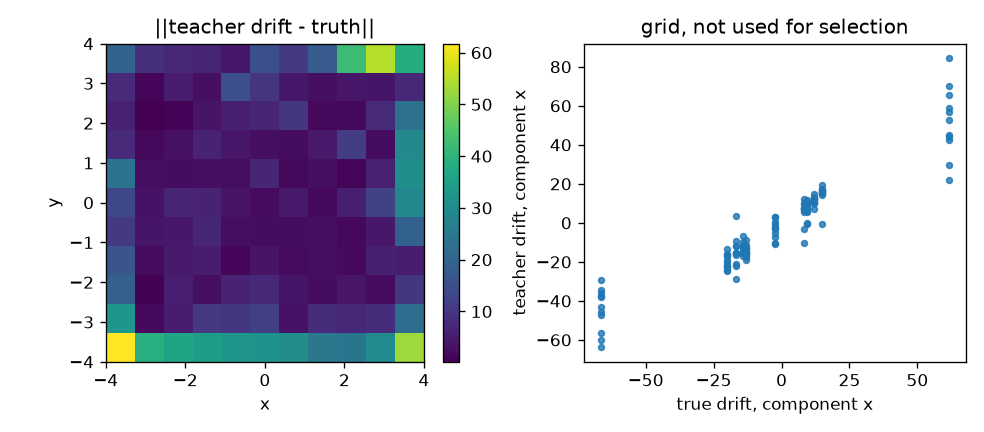

# Day 18 — Guan et al. (2026) nn-APPEX

- Date: 2026-11-10（Asia/Tokyo）
- Paper: Vincent Guan, Joseph Janssen, Nicolas Lanzetti, Antonio Terpin, Geoffrey Schiebinger, Elina Robeva,
  *Gradient-Flow SDEs Have Unique Transient Population Dynamics*.
- 採録先と年: **AISTATS 2026**（第 29 回 International Conference on Artificial Intelligence and Statistics、査読付き、PMLR 300, pp. 2449–2457）。preprint ではない。
  https://proceedings.mlr.press/v300/guan26a.html
  PDF: https://raw.githubusercontent.com/mlresearch/v300/main/assets/guan26a/guan26a.pdf
  arXiv: https://arxiv.org/abs/2505.21770
  Code: https://github.com/guanton/identifying-gradient-flow-sdes
- 成果物: config `configs/daily_neural_sde_day18.json` /
  コード `src/daily_neural_sde/day18_guan_nnappex.py` /
  数値 `outputs/daily_neural_sde/day18/results.json`、
  teacher 重み `teacher_nnappex_weights.json` / `teacher_fixed_sigma_weights.json`、
  symbolic モデル `symbolic_drift.json` / `symbolic_sigma.json`、
  TeX `symbolic_sde.tex`（このフォルダにも同じ式）、
  格子図 `drift_grid.png`、
  tests `tests/test_daily_neural_sde_day18.py`（8 tests。NumPy 1.26.4 で日次スイート全体は 160 tests が通過）。
- 実行: `python3 -m src.daily_neural_sde.day18_guan_nnappex`
  （seed 18、Python 3.12.3、PyTorch 2.15.0+cpu、NumPy 2.5.4、CUDA なし、171.9 秒）。
  学習プロセスが import した NumPy は 2.5.4 である。ユニットテストはシリーズの NumPy 1.26.4 でも同じ 8 件が通過する。
  実行時の shape は query \((3,2)\)、ポテンシャル \((3,)\)、drift \((3,2)\)。
  `results.json` の `git_head` は実行時点の親 `c6dcce6` である。

この 2 次元座標は Styblinski–Tang ポテンシャルのベンチマーク状態であり、遺伝子規制の式でも潜在遺伝子空間の式でもない。
推定式は teacher の近似であって、真の勾配流 SDE の発見ではない。
拡散係数はスカラーの最尤推定であり、ニューラルネットワークではない。

## 0. 前日までの反省の適用

実行前に config へ入れた。test のあとでしきい値は動かしていない。
根拠の数値は評価 seed とは別の probe seed 18099 だけで見積もり、`threshold_basis` に残した。

1. **対 teacher と対真値を同じ表に置く (Day 5)**。残差 RMS を NRMSE の横に置く (Day 11)。
2. **失敗の帰属に oracle 天井を置く (Day 10、Day 16)**。真値への次数 3 の通常最小二乗と、teacher への次数 3・しきい値 0 の fit を、test に 1 回だけ当てた。選択には使わない。probe では真値 oracle が \(10^{-15}\) だった。
3. **VIF ゲートは閉じた形の許可ではない (Day 13、Day 16、Day 17)**。ゲートは次数 3 の自由多項式、定数列を除く。probe の VIF は 15.3 で、ゲート 10 は上げていない。
4. **格子の RMS を軌道上の残差 RMS の横に置く (Day 16、Day 17)**。格子は \([-4,4]^{2}\) の \(11\times 11\) で、選択には使わない。RMS が軌道上の残差の 2 倍を超えたら増幅として記録する。
5. **1 步 NLL を場の同定と読まない (Day 14、Day 16、Day 17)**。\(|b|\Delta t/(\sigma\sqrt{\Delta t})\) が 0.25 未満なら `drift_step_ratio_blind`。NLL 差が 0.05 nats 未満かつ teacher 対真値の NRMSE が 0.30 を超えるときだけ `nll_hides_drift` とする。
6. **法則指標にはモンテカルロフロアを置く (Day 10、Day 17)**。フロアが teacher のしきい値を超えたら H5 は不定である。終端共分散は平均経路と別に採点する。
7. **失敗クラスを分ける (Day 4)**。`non_finite` と `outside_radius`。半径 12 は数値のガードであり、論文の境界ではない。
8. **構造を検証の候補に入れる (Day 7)**。teacher はポテンシャルの勾配なので、勾配多項式と成分ごとの STLSQ を同じ検証 NRMSE で比べる。同点は小さい次数、小さいしきい値、その次に勾配構造。
9. **引数を壊した感度を置く (Day 17)**。ドリフトは時刻を持たない。\(y\) だけを独立に置換した相対 RMS を、真値の感度との差で採点する。

## 1. 論文要約

### 1.1 問題と提案

勾配流 SDE

$$
dX_t = -\nabla\Psi(X_t)\,dt + \sigma\,dW_t
$$

のドリフトとスカラー拡散を、時間周辺だけから同定する問題である。
平衡では拡散とポテンシャルが混ざる。過渡的な周辺では、両方が可同定である、というのが Theorem 3.2 である。
有限個の周辺については、可算個の候補集合のなかでは 3 時刻で確率 1 だと Theorem 3.3 は述べる。

nn-APPEX はその設定の推定器である。参照 SDE に対する多時点 Schrödinger bridge で経路を結び、その経路の Euler 尤度でニューラルなドリフトを最尤し、残差の二次変分で \(\sigma^{2}\) を閉じた形で更新する（式 (16)、(17)、Algorithm 1）。
公開コードのドリフトは、SiLU のスカラーポテンシャル \(\phi_\theta\) の \(b=-\nabla\phi_\theta\) である。
WOT はブラウン参照の 1 回で止まり、SBIRR は \(\sigma^{2}\) を固定したままドリフトだけを反復する。

Section 5.1 は \(\sigma^{2}=0.2\)、初期分布はランダムな混合正規、粒子 2000、Euler–Maruyama を \(\Delta t=0.01\) で 2 步、周辺は \(t=0,0.01,0.02\) の 3 枚である。
ポテンシャルは 5 種類で、ネットワークは幅 128、隠れ層 2、SiLU、Adam、学習率 \(3\times 10^{-3}\)、各外側反復で 500 epoch、外側は 30 回である。
拡散の初期値は \(\sigma^{2}\times 10^{U[-1,1]}\) である。
評価は \([-4,4]^{2}\) の格子上の正規化絶対誤差とコサイン類似度である。

### 1.2 選定理由

Day 17 は Cox 過程のカウントから潜在拡散のドリフトを変分 ELBO で学ぶ論文だった。
本日は、軌跡ではなく 3 枚の周辺だけから、勾配流のドリフトとスカラー拡散を Schrödinger bridge の交互更新で学ぶ論文を選んだ。
採録は AISTATS 2026 で、ドリフトがニューラルネットである査読付き論文のうち新しいものである。
系は Section 5.1 の Styblinski–Tang である。真のドリフトは各成分が立方で、次数 3 の冪ライブラリに入る。
拡散は状態に依らないスカラーで、ニューラルネットではない。
Lorenz、OU、van der Pol、Lotka–Volterra、スコア、NUNO、FIM、LieStoNet の \(1/x\)、CIR は避けた。
二次ポテンシャルは Ornstein–Uhlenbeck なので使っていない。

## 2. データと Neural SDE の入手・再構成

### 2.1 データと teacher

真の Ito SDE は、公開コードの `styblinski_tang` と同じポテンシャル

$$
\Psi(x,y)=\frac12\sum_{u\in\{x,y\}}\bigl(u^{4}-16u^{2}+5u\bigr)
$$

から

$$
\begin{aligned}
dx &= \bigl(-2x^{3}+16x-2.5\bigr)\,dt + \sqrt{0.2}\,dW^{x},\\
dy &= \bigl(-2y^{3}+16y-2.5\bigr)\,dt + \sqrt{0.2}\,dW^{y}.
\end{aligned}
$$

初期分布は公開の `sample_random_gmm` に合わせた。成分数は \(\{1,\ldots,10\}\) から一様、平均は \([-3,3]^{2}\)、等方分散は \([0.5,1]\)、重みは Dirichlet\((1,\ldots,1)\) である。
seed 18 の実現は成分 9、train の状態範囲は \(x\in[-4.90,4.02]\)、\(y\in[-3.59,4.70]\) である。
生成半径 12 の外に出た粒子は 0 である。
\(\Delta t=0.01\)、2 步。分割は粒子単位で train 512、validation 128、test 128。teacher が見るのは train の 3 周辺だけである。各時刻の中では結合をシャッフルし、真のペアは渡さない。

拡散の初期値は Section 5.1 の通り、seed 18 の独立な Generator で \(0.2\times 10^{U[-1,1]}=0.1258\) である。相対誤差は 0.371 で、H2 の 0.20 より大きい。
外側 30 回、各回は新しい幅 128・深さ 2 の SiLU ポテンシャルを 500 epoch、Adam \(3\times 10^{-3}\)、バッチ 512 で式 (16) に当てる。
多時点 Sinkhorn は公開の対数域 IPF（\(\varepsilon=1\)、減衰 0.5、上限 200、許容 \(10^{-5}\)）である。
最後の有限なドリフトを採る。検証の場では止めない。

適応実行は止まらず、\(\hat\sigma^{2}\) は 1 回目 0.552、2 回目の最大 0.613 から、30 回目の 0.171 へ下がった。
固定拡散の対照は同じ事前 0.1258 のまま、ドリフトだけを 30 回更新した。選択には使わない。

### 2.2 逸脱の明示

1. 論文の主実験は 5 ポテンシャル × 10 seed × 粒子 2000 で、検証分割はない。本日は Styblinski–Tang の 1 seed、粒子 512 / 128 / 128 の軌道分割である。teacher は train 周辺だけを見る。
2. 実装は JAX / Equinox / float32 ではなく、PyTorch の float64 と Linear の既定初期化である。最適化の幅、深さ、SiLU、学習率、epoch 数、外側回数は論文の既定に合わせた。
3. 乱数はグローバルな `np.random` ではなく、用途ごとの Generator である。
4. 格子診断は \(11\times 11\) である。論文の \(51\times 51\) ではない。選択には使わない。
5. 一様初期、Gibbs 初期、JKOnet*、WOT、他の 4 ポテンシャル、ヒト ES 細胞は範囲外である。固定拡散は SBIRR 型の対照として 1 本だけ残した。
6. 拡散の多項式は、スカラー teacher へのライブラリ探針である。ニューラルな拡散ではない。

## 3. 仮説（config に事前凍結）

probe seed 18099 の真値だけで見積もった。ドリフト RMS 17.2、ステップ比 4.15、次数 3 oracle は \(10^{-15}\)、VIF 15.3、バイアス 2 の対経路 RMSE 0.0258、真の経路での \(\sigma^{2}\) 最尤 0.198、事前の相対誤差 0.371、1024 本の平均経路フロア 0.0443、真値の粗視化終端 RMSE 0.148、時刻シャッフルの相対 RMS 1.10。test のあとでしきい値は動かしていない。

- **H1** (ドリフト): symbolic 対 teacher \(\le 0.25\)、teacher 対真値 \(\le 0.40\)、symbolic 対真値 \(\le 0.50\)。残差 RMS は併記し、ゲートにはしない。pass は \(-2u^{3}+16u-2.5\) ではない。
- **H2** (拡散): 多項式対スカラー teacher の test NRMSE \(\le 0.05\)、かつ非正の割合 \(\le 0.02\)。別に \(|\hat\sigma^{2}-0.2|/0.2\le 0.20\)。格子の NRMSE が軌道上の 5 倍を超えたら局所的な影として記録する。
- **H3**: 次数 3 の自由ライブラリの VIF（定数列を除く）が 10 を超えたら不定。10 以下でも閉じた形としては読まない。
- **H4**: test と同じ初期値と Wiener 増分、2 步。失敗率は各モデル \(\le 0.05\)、symbolic と teacher の差 \(\le 0.02\)。外れたら不定。内側のときだけ、対の経路 RMSE（symbolic 対 teacher \(\le 0.08\)、teacher 対真値 \(\le 0.10\)）、終端共分散の相対誤差（\(\le 0.45\)、\(\le 0.55\)）、ドリフトの teacher 対真値 \(\le 0.40\)、をすべて要求する。
- **H5**: 同じ混合から独立に 1024 本。平均経路 RMSE は teacher \(\le 0.09\)、symbolic \(\le 0.11\)。終端共分散の相対誤差は teacher \(\le 0.50\)、symbolic \(\le 0.60\)。失敗率 \(>0.05\)、または真値対真値のフロアが teacher のしきい値を超えたら不定。
- **H6**: \(y\) を独立に置換した相対 RMS が、真値との絶対差で teacher も symbolic も \(\le 0.20\)。格子で teacher 対真値 \(\le 0.60\)、symbolic 対 teacher \(\le 0.45\)。
- **H7**: teacher の \(\Delta t=0.01\) と \(\Delta t=0.02\) の終端 RMSE \(\le 0.40\)、かつ両方が有限な割合 \(\ge 0.95\)。probe の真値ギャップ 0.148 より上に置いた。
- **H8**: test で、適応 teacher の対真値 NRMSE が固定拡散より少なくとも 0.05 小さく、かつ適応側が \(\le 0.45\)。

## 4. 方法

teacher のドリフトへの直接 query。特徴は観測状態 \((x,y)\)。時刻は入らない。
SINDy の標準化は train query だけから取る。ライブラリは \((x,y)\) の冪だけである。三角関数、指数、有理式は入れない。
次数 \(\{1,2,3\}\)、しきい値 \(\{0, 0.02, 0.05, 0.1, 0.2, 0.35\}\)、ridge \(10^{-4}\)。
勾配候補は、標準化座標の次数 4 までのポテンシャルで、ドリフトを \(-\nabla\phi\) に制約する。
検証 NRMSE の最小。test はこの選択のあと 1 回。

選択結果: ドリフトは次数 3・しきい値 0.02・勾配構造（活性 9、ポテンシャル項 14、検証スコア 0.2253）。
同じ次数のしきい値 0 は 0.2254 で 14 項、自由多項式のしきい値 0 は 0.2275 である。
次数 2・しきい値 0 の勾配は 0.828 である。立方を落とすと検証は約 4 倍悪くなる。
拡散の探針は次数 1・しきい値 0（検証スコア \(10^{-15}\)）。標準化座標の線形係数は \(10^{-17}\) で、展開すると定数だけが残る。

診断として、真値への次数 3・ridge 0 の通常最小二乗と、teacher への自由多項式の次数 3・しきい値 0 を test で 1 回評価した。選択には使わない。
シミュレーションは失敗をラッチし、`non_finite` と `outside_radius` を分ける。

## 5. 結果

### 5.1 仮説の成否一覧

| 仮説 | 指標 | 値 | しきい値 | 判定 |
|---|---|---|---|---|
| H1 drift | symbolic 対 teacher | 0.190 | \(\le 0.25\) | この項は内側 |
| H1 drift | teacher 対真値 | 0.195 | \(\le 0.40\) | この項は内側 |
| H1 drift | symbolic 対真値 | 0.0463 | \(\le 0.50\) | **pass** |
| H1 残差 RMS | symbolic 対 teacher / teacher 対真値 / symbolic 対真値 | 2.87 / 2.89 / 0.685 | （併記） | teacher RMS 15.12、真値 RMS 14.81 |
| H1 天井 | 自由多項式の次数 3・しきい値 0 対 teacher / 次数 3 OLS 対真値 | 0.192 / \(2.3\times 10^{-15}\) | （診断） | 真値はライブラリに入る。対 teacher の 0.192 は選択式 0.190 とほぼ同じ |
| H2 蒸留 | 多項式対 \(\hat\sigma\) | \(1.6\times 10^{-15}\) | \(\le 0.05\) | **pass** |
| H2 非正 | \(\sigma\le 0\) の割合 | 0 | \(\le 0.02\) | pass |
| H2 真値 | \(\|\hat\sigma^{2}-0.2\|/0.2\) | 0.144 | \(\le 0.20\) | **pass**。事前は 0.371 でこのゲートの外 |
| H2 影 | 格子 NRMSE / 軌道上 | ともに \(10^{-15}\) | 5 倍 | 影ではない |
| H3 VIF | 次数 3、定数列を除く | 6.93 | \(\le 10\) | ゲートは内側。**閉じた形ではない** |
| H4 失敗 | truth / teacher / symbolic | 0 / 0 / 0 | \(\le 0.05\)、差 \(\le 0.02\) | 内側。H4 は採点された |
| H4 経路 | symbolic 対 teacher / teacher 対真値 | 0.0332 / 0.0339 | \(\le 0.08\) / \(\le 0.10\) | この項は内側 |
| H4 終端共分散 | symbolic 対 teacher / teacher 対真値 | 0.00424 / 0.00921 | \(\le 0.45\) / \(\le 0.55\) | この項は内側 |
| H4 ドリフト | teacher 対真値 | 0.195 | \(\le 0.40\) | **pass** |
| H5 平均経路 | teacher / symbolic / 真値フロア | 0.0808 / 0.0336 / 0.0397 | \(\le 0.09\) / \(\le 0.11\) | teacher はフロアの約 2 倍でしきい値の内側。symbolic はフロア未満 |
| H5 終端共分散 | teacher / symbolic / 真値フロア | 0.0411 / 0.0660 / 0.0618 | \(\le 0.50\) / \(\le 0.60\) | 数値は内側。teacher はフロア未満なので検出ではない |
| H5 失敗 | truth / teacher / symbolic | 0 / 0 / 0 | \(\le 0.05\) | 内側。H5 は採点された |
| H6 シャッフル | teacher / symbolic / 真値 | 1.004 / 1.009 / 0.977 | 差 \(\le 0.20\) | 差は 0.0275 と 0.0319 |
| H6 格子 NRMSE | teacher 対真値 / symbolic 対 teacher | 0.388 / 0.442 | \(\le 0.60\) / \(\le 0.45\) | **pass**。symbolic 側は 0.008 の余裕 |
| H6 格子 RMS | teacher 対真値 / symbolic 対 teacher | 11.6 / 11.8 | （併記） | 軌道上の残差 RMS 2.89 の 4.01 倍。`H6_amplified` |
| H7 | 終端 RMSE / 有限な割合 | 0.0872 / 1 | \(\le 0.40\) / \(\ge 0.95\) | pass |
| H8 | 適応 NRMSE / 固定 NRMSE / 差 | 0.195 / 0.210 / 0.0147 | 差 \(\ge 0.05\)、適応 \(\le 0.45\) | **fail** |

1 步の尺度は、train 上の真値でステップ比 4.12 である。`drift_step_ratio_blind` ではない。
test の 1 步ガウス NLL は teacher \(-2.714\)、真値 \(-3.360\)、差 0.645 nats である。
`nll_hides_drift` は偽である。差は 0.05 nats より大きい。
残差 RMS 2.89 を \(\tfrac12\|\Delta b\|^{2}\Delta t/\sigma^{2}\) の桁に入れると約 0.4 nats で、観測した差と同じ桁である。
\(\hat\sigma^{2}=0.171\) と \(0.2\) の差だけでは、この 0.645 nats は出ない。

test 上のコサイン類似度は teacher 対真値 0.967、正規化絶対誤差の中央値は 0.172 である。どちらもゲートではない。
3 次項の RMS 比は真値 2.01、symbolic 1.98 で、0.15 より大きい。交差項の RMS 比は symbolic で 0.0175 である。
teacher の \(\partial b_x/\partial y\) の RMS は 9.16、ドリフト RMS 15.12 に対して 0.606 である。
symbolic の同じ偏微分は 0.195 である。真値は 0 である。

### 5.2 推定した symbolic SDE

標準化座標のドリフトは勾配構造、活性 9 である。
展開は `symbolic_sde.tex` と一致する。これは teacher の多項式近似であり、上の Styblinski–Tang ではない。
拡散の標準化座標には \(10^{-17}\) の線形係数が残る。展開の打ち切り \(10^{-12}\) より小さいので、式は定数である。

$$
\begin{aligned}
b_x(x,y) &= - 2.338 - 0.05598\,y + 15.95\,x - 0.09521\,x y - 0.0197\,x^{2} - 1.97\,x^{3},\\
b_y(x,y) &= - 2.326 + 16.97\,y - 0.05598\,x + 0.04174\,y^{2} - 0.04761\,x^{2} - 2.121\,y^{3},\\
\sigma_x(x,y) &= 0.4137,\\
\sigma_y(x,y) &= 0.4137.
\end{aligned}
$$

\(\hat\sigma^{2}=0.17115\) なので \(\hat\sigma=\sqrt{\hat\sigma^{2}}=0.4137\) である。
H4 と H5 の teacher 拡散はこの定数である。真値の拡散は \(\sqrt{0.2}\) である。

\(x^{3}\) の係数 \(-1.97\) と \(x\) の係数 \(15.95\) は、真値 \(-2\) と \(16\) に数値として近い。
\(y^{3}\) は \(-2.12\)、\(y\) は \(16.97\)、定数は \(-2.34\) と \(-2.33\) で、真値 \(-2.5\) とは 0.16 離れる。
同じ式は \(xy\) と \(y\) の漏れを持つ。VIF は 6.93 でゲートの内側である。この近さは \(-2u^{3}+16u-2.5\) の回復ではない。
teacher の混合偏微分が 9.16 あるので、多項式の見た目は teacher の局所勾配そのものでもない。

## 6. 考察

軌道上の H1 は通った。teacher 対真値 0.195、symbolic 対 teacher 0.190、symbolic 対真値 0.0463 である。
真値への次数 3 oracle は \(10^{-15}\) なので、真のドリフトはライブラリに入っている。
teacher への自由多項式の次数 3・しきい値 0 は 0.192 で、選択した勾配式の 0.190 とほぼ同じである。
しきい値 0.02 は項を 14 から 9 へ落としたが、検証スコアは 0.2254 から 0.2253 に動いただけである。
残りの 0.19 は、しきい値が落とした分ではない。次数 3 の勾配多項式がこの teacher の値をそれ以上は追えない分である。

その射影は、teacher より真値に近い。0.0463 対 0.195 である。
次数 2 の検証スコアは 0.828 なので、近づいた先は線形ではなく立方を含む。
ただし teacher の \(\partial b_x/\partial y\) は RMS 9.16 で、値の NRMSE 0.195 はこの局所勾配を見ていない。
symbolic の同じ偏微分は 0.195 まで落ちる。
値の近さと、混合偏微分の大きさは、この teacher では別の事実である。

H8 は落ちた。適応側の対真値 NRMSE 0.195 は、固定拡散 0.210 より 0.0147 小さいだけである。
ゲートは 0.05 である。両方とも 0.45 の内側なので、落ちたのは改善幅である。
\(\hat\sigma^{2}\) 自体は事前 0.126 から 0.171 へ動き、真値 0.2 との相対誤差 0.144 で H2 は通った。
この 1 seed・2 步・粒子 512 の切り取りでは、拡散の更新はドリフト場を 0.05 以上は動かしていない。
論文が 10 seed と 5 ポテンシャルで示した優劣を、本日の 1 本は再現しない。

H6 の格子 NRMSE は 0.388 と 0.442 でゲートの内側である。
絶対誤差はそうではない。格子 RMS 11.6 は、軌道上の残差 RMS 2.89 の 4.01 倍である。
図の四隅、とくに \((-4,-4)\) 付近で誤差が大きい。NRMSE の pass は、分母が格子上で大きいことの反映でもある。
コサイン 0.971 は向きが合っていることを言うが、この増幅を消さない。

H4 の対経路 RMSE 0.034 は、probe でドリフトに定数 2 を足したときの 0.026 と同じ桁である。
地平は 0.02 なので、残差 RMS 2.89 の経路への寄与は \(\Delta b\cdot T\) の桁に収まる。
失敗率は 0 で、ドリフトの teacher 対真値も 0.40 の内側なので、H4 は不定ではない。
経路の pass は、H1 がすでに見ている場より細かい証拠ではない。

H5 の平均経路は teacher 0.0808、フロア 0.0397、しきい値 0.09 である。
フロアを上回っているのでゼロ誤差ではないが、ゲートは通った。
終端共分散の相対誤差 0.0411 はフロア 0.0618 を下回る。この項は検出ではない。
symbolic の平均経路 0.0336 もフロア未満である。

H7 の終端 RMSE 0.087 は、probe の真値ギャップ 0.148 より小さい。
粒子の雲が違うので、teacher の方が精度の高い積分だとは読まない。
この 2 步では、学習したドリフトは評価に使った Euler を壊していない。

## 7. 反省

値の NRMSE が 0.2 付近でも、ポテンシャルネットの混合偏微分はドリフト RMS の半分を超えうる。
次数 3 への射影がその teacher より真値に近くなることもある。
翌日は、値の NRMSE の横に混合偏微分の RMS を置き、射影の近さを局所場の回復と読まない。
拡散のスカラーが真値へ動いても、ドリフト NRMSE の改善は 0.01 台に留まりうる。改善幅のゲートを事前に置く。
格子 NRMSE が内側でも、格子 RMS と軌道上の残差 RMS の比は別に残す。
