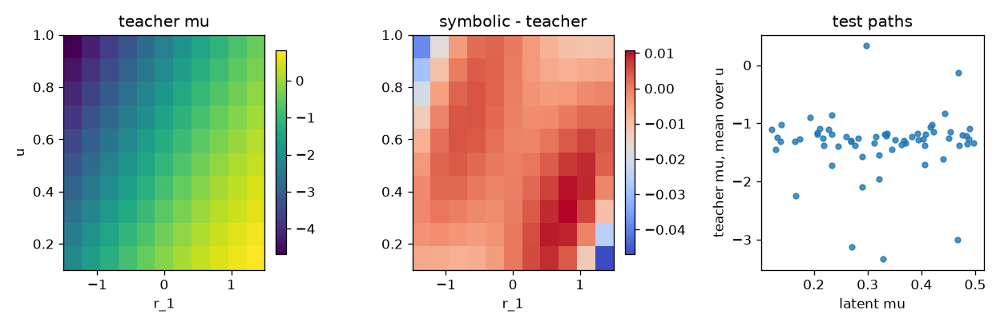

# Day 19 — Gao et al. (2025) Neural MJD

- Date: 2026-11-11（Asia/Tokyo）
- Paper: Yuanpei Gao, Qi Yan, Yan Leng, Renjie Liao,
  *Neural MJD: Neural Non-Stationary Merton Jump Diffusion for Time Series Prediction*.
- 採録先と年: **NeurIPS 2025**（第 39 回 Conference on Neural Information Processing Systems、査読付き）。preprint ではない。
  https://proceedings.neurips.cc/paper_files/paper/2025/hash/be86db1a7a293eec8d291edf9fcaa550-Abstract-Conference.html
  PDF: https://proceedings.neurips.cc/paper_files/paper/2025/file/be86db1a7a293eec8d291edf9fcaa550-Paper-Conference.pdf
  Code: https://github.com/DSL-Lab/neural-MJD
- 成果物: config `configs/daily_neural_sde_day19.json` /
  コード `src/daily_neural_sde/day19_gao_neural_mjd.py` /
  数値 `outputs/daily_neural_sde/day19/results.json`、
  teacher 重み `teacher_mjd_weights.json` / `teacher_bs_weights.json`、
  symbolic モデル `symbolic_mu.json` / `symbolic_sigma.json` / `symbolic_lam.json` / `symbolic_nu.json` / `symbolic_gamma.json`、
  TeX `symbolic_sde.tex`（このフォルダにも同じ式）、
  切片図 `drift_grid.png`、
  tests `tests/test_daily_neural_sde_day19.py`（8 tests）。
- 実行: `python3 -m src.daily_neural_sde.day19_gao_neural_mjd`
  （seed 19、Python 3.12.3、PyTorch 2.15.0+cpu、NumPy 2.5.4、CUDA なし、15.5 秒）。
  実行時の shape は query \((640, 10)\)、レート 5 本が各 \((640,)\)。
  `results.json` の `git_head` は実行時点の親 `5080199` である。

この座標は、文脈の対数収益 9 個と未来時刻 \(u\) である。株価の式でも遺伝子規制の式でもない。
推定式は teacher の多項式近似であって、潜在の Merton パラメータの発見ではない。
ドリフト率 \(\mu\) と拡散率 \(\sigma\) はどちらもニューラルネットワークの出力である。

## 0. 前日までの反省の適用

実行前に config へ入れた。test のあとでしきい値は動かしていない。
根拠の数値は評価 seed とは別の probe seed 19099 の 128 窓と、Uniform\((0.1,0.5)\) の解析的フロアだけで見積もり、`threshold_basis` に残した。

1. **値の NRMSE の横に混合偏微分と勾配の RMS を置く (Day 18)**。H9 は \(\partial^2\mu/\partial r_1\partial r_2\) の RMS を teacher の \(\mu\) の RMS で割った比である。値の一致を局所場の回復とは読まない。
2. **対 teacher と対真値を同じ表に置き、定数予測フロアを併記する (Day 5、Day 10)**。test 上の定数予測 NRMSE は \(\mu\) が 0.320、\(\sigma\) が 0.378 である。識別のゲート 0.30 はこのフロアより下に置いた。
3. **失敗の帰属に oracle 天井を置く (Day 10、Day 16)**。teacher への次数 3・しきい値 0 を test で 1 回だけ当てた。選択には使わない。
4. **平均の合格を field 回復と読まない (Day 11)**。H2 の平均水準と H1 の NRMSE は別のゲートである。
5. **VIF ゲートは閉じた形の許可ではない (Day 13、Day 17、Day 18)**。ゲートは次数 3、定数列を除く、しきい値 10。probe ではこのライブラリの VIF が \(10^9\) の上限に当たった。ゲートは上げていない。
6. **格子の RMS を軌道上の残差 RMS の横に置く (Day 16、Day 18)**。切片は \(r_1\in[-1.5,1.5]\)、\(u\in\{0.1,\ldots,1\}\)、他の収益は 0。選択には使わない。
7. **1 步の情報量を場の同定と読まない (Day 16、Day 17、Day 18)**。probe のステップ比は 0.117 で、盲ゲート 0.25 より小さい。
8. **引数を壊した感度を置く (Day 17)**。定常 MJD の潜在率は収益の順序にも未来時刻にも依らない。シャッフルと時刻反転の相対 RMS をゲートにした。
9. **失敗クラスを分ける (Day 4)**。`nonpositive_coefficient`、`jump_cap`、`non_finite`、`outside_radius`。半径 12 は対数価格の数値ガードであり、論文の境界ではない。
10. **法則指標にはモンテカルロフロアを置く (Day 10、Day 18)**。フロアが teacher のしきい値を超えたら H5 は不定である。

## 1. 論文要約

### 1.1 問題と提案

非定常な時系列の予測を、時間非一様な Merton ジャンプ拡散のシミュレーションとして書く。
未来時刻 \(t\) のパラメータは、過去と文脈を入力にする一つのネットワークの出力である。

$$
\begin{aligned}
dS_t &= S_t(\mu_t-\lambda_t k_t)\,dt + S_t\sigma_t\,dW_t + S_t\int (y-1)\,N(dt,dy),\\
k_t &= \exp(\nu_t+\gamma_t^2/2)-1,\\
(\mu_t,\sigma_t,\lambda_t,\nu_t,\gamma_t) &= f_\theta(S_0,S_{-1},\ldots,C,t).
\end{aligned}
$$

補償後の形では、ドリフト率は \(\mu_t\) で、ジャンプは補償ポアソン測度に対して取る。
学習は、ジャンプ数を \(\kappa\) で打ち切った遷移尤度と、条件付き平均価格への二乗罰則である（式 (12)、式 (13)、Algorithm 1、Theorem 4.1）。
論文は \(\kappa=5\)、罰則の重み \(\omega=1\) とする。
推論には Euler–Maruyama のリスタートがある。本日の採点はリスタートを使わない。

Appendix D.2 の合成データは、区間 \([0,1]\) を 100 步の Euler で進めたスカラー MJD である。
各経路の潜在率は \(\mu\sim U(0.1,0.5)\)、\(\sigma\sim U(0.1,0.5)\)、\(\lambda\sim U(3,10)\)、\(\nu\sim U(-0.1,0.1)\)、\(\gamma\sim U(0.5,1.0)\) である。
予測は過去 10 フレームから未来 10 フレームである。

### 1.2 選定理由

Day 18 は勾配流のポテンシャルネットワークで、拡散はスカラーの最尤だった。
本日は、ドリフト率と拡散率が両方ともニューラルネットワークで、さらに強度とジャンプサイズもニューラルな論文を選んだ。
採録は NeurIPS 2025 である。
系は Appendix D.2 のスカラー MJD で、状態依存の多項式場ではなく、文脈窓から時間非一様な率を出す。
Lorenz、OU、van der Pol、Lotka–Volterra、幾何 SDE、Jia & Benson の状態依存ジャンプ、CIR、勾配流は避けた。
SafeGraph と S&P 500 は範囲外である。

## 2. データと Neural SDE の入手・再構成

### 2.1 データと teacher

潜在の Ito SDE は Appendix D.2 の範囲のままである。
時間刻みは \(\Delta t=0.01\)。1 本の経路から窓を 1 枚だけ取る。
文脈は価格 10 点、つまり対数収益 \(r\in\mathbb{R}^9\)。未来は 10 步。
現在価格は文脈の最後の点である。
分割は経路単位で train 256、validation 64、test 64。teacher は train だけを見る。
棄却は対数価格の絶対値が 12 を超えた経路で、0 本だった。
train を含む全 384 本の収益の標準偏差は 0.203、最大絶対値は 2.372 である。
潜在率の平均は \(\mu=0.315\)、\(\sigma=0.299\)、\(\lambda=6.451\)、\(\nu=0.00135\)、\(\gamma=0.754\) である。

teacher は幅 64、深さ 2、SiLU の MLP である。
入力は \((r,u)\)、\(u=\tau/10\in\{0.1,\ldots,1\}\) である。
出力は \(\mu\)、\(\mathrm{softplus}\) の \(\sigma\) と \(\lambda\) と \(\gamma\)、そして \(\nu\) である。
損失は Algorithm 1 に合わせ、遷移は条件付き平均の対数価格に条件付け、罰則は \((S-\hat S)^2\)、\(\omega=1\)、\(\kappa=5\) である。
対数価格は罰則の指数を取る直前に \(\pm 4\) で切る。尤度は切らない。
epoch は 80、Adam、学習率 \(10^{-3}\)、勾配クリップ 1。検証損失では止めない。
train 損失は 1.722 から 0.167 へ下がった。

Neural BS は同じ MLP で \(\lambda=\nu=0\)、\(\gamma=1\) に固定した対照である。選択には使わない。
損失は 22.49 から 0.636 へ下がった。

### 2.2 逸脱の明示

1. 論文は経路 10,000 本の stride 1 の窓を 60/20/20 に分ける。同じ経路の窓が分割をまたぐ。本日は経路単位の 256/64/64 で、各経路の先頭 20 フレームだけを使う。
2. 論文の予測器は Transformer である。論文はアーキテクチャを制限しないと書いており、Transformer は他のベースラインとの共有である。本日は幅 64、深さ 2 の MLP である。
3. 入力は \([0,1]\) へ min-max した生の価格ではない。対数収益と未来時刻である。MJD はスケール不変で、大域的な min-max は最も重い経路に支配される。
4. 尤度のビン幅は \(\Delta t=0.01\) である。Appendix D.2 の率は \([0,1]\) 上の Euler の時間単位なので、フレームを \(\delta=1\) と置くと潜在率と尤度の時間がずれる。
5. 罰則は論文の \((S-\hat S)^2\) だが、価格を \([0,1]\) に写したあとではなく、対数を \(\pm 4\) で切ってから指数を取った値である。
6. グラフ文脈、SafeGraph、S&P 500、リスタート付き Euler の予測指標は範囲外である。採点のシミュレーションは共有した Wiener と指数時計による Euler–Poisson である。
7. ライブラリは \((r_1,\ldots,r_9,u)\) の冪だけである。三角関数、指数、有理式は入れない。

## 3. 仮説（config に事前凍結）

probe seed 19099 の 128 窓と解析的フロアで見積もった。
Uniform\((0.1,0.5)\) の定数予測 NRMSE は 0.359、probe 上の経験値は 0.354 である。
ステップ比は 0.117。\(\mu\) と \(\sigma\) だけを probe の平均に置き、ジャンプ率とノイズを真値のまま共有した経路 RMSE は 0.030 である。
真値対真値の平均経路フロアは 0.070、終端分散のフロアは 0.107 で、どちらも H5 のしきい値より小さい。
次数 3 の VIF は上限 \(10^9\) に当たった。ゲート 10 は上げていない。
test のあとでしきい値は動かしていない。

- **H1** (\(\mu\) と \(\sigma\) の両方): symbolic 対 teacher \(\le 0.25\)、teacher 対真値 \(\le 0.30\)、symbolic 対真値 \(\le 0.50\)。0.30 は定数フロア 0.359 より下なので、履歴を使わない teacher は識別で落ちる。pass は潜在の MJD 率ではない。
- **H2** (拡散): 多項式対 teacher の test NRMSE \(\le 0.25\)、かつ非正の割合 \(\le 0.02\)。別に \(|\mathrm{mean}(\hat\sigma)-0.3|/0.3\le 0.20\)。切片 NRMSE が軌道上の 5 倍を超えたら局所的な影として記録する。
- **H3**: 次数 3 の VIF（定数列を除く）が 10 を超えたら不定。10 以下でも閉じた形としては読まない。
- **H4**: test と同じ初期対数価格と共有ノイズ、10 步。失敗率は各モデル \(\le 0.05\)、symbolic と teacher の差 \(\le 0.02\)。外れたら不定。内側のとき、対数価格の経路 RMSE（symbolic 対 teacher \(\le 0.08\)、teacher 対真値 \(\le 0.10\)）、終端分散の相対誤差（\(\le 0.50\)、\(\le 0.60\)）、\(\mu\) と \(\sigma\) の teacher 対真値の最大が \(\le 0.30\)、をすべて要求する。
- **H5**: 新しい 256 本。平均対数経路 RMSE は teacher \(\le 0.12\)、symbolic \(\le 0.15\)。終端分散の相対誤差は teacher \(\le 0.50\)、symbolic \(\le 0.60\)。失敗率 \(>0.05\)、または真値対真値のフロアが teacher のしきい値を超えたら不定。
- **H6**: 収益の行ごとのシャッフルと、\(u\mapsto 1.1-u\) の相対 RMS が teacher も symbolic も \(\le 0.20\)。切片で symbolic 対 teacher \(\le 0.45\)。
- **H7**: 同じノイズで、最初の未来ビンの率を 10 步に固定した終端対数 RMSE \(\le 0.20\)、かつ両方が有限な割合 \(\ge 0.95\)。
- **H8**: Neural BS の \(\sigma\) の対真値 NRMSE から MJD のそれを引いた差 \(\ge 0.05\)、かつ MJD 側が \(\le 0.45\)。
- **H9**: teacher の \(\partial^2\mu/\partial r_1\partial r_2\) の RMS を \(\mu\) の RMS で割った比 \(\le 0.50\)。

## 4. 方法

teacher の 5 つの率への直接 query。特徴は \((r,u)\)。
SINDy の標準化は train query だけから取る。
次数 \(\{1,2,3\}\)、しきい値 \(\{0, 0.02, 0.05, 0.1, 0.2, 0.35\}\)、ridge \(10^{-4}\)。
検証 NRMSE の最小。同点は小さい次数、その次に小さいしきい値。
率ごとに別々に選ぶ。test はこの選択のあと 1 回。

選択結果: \(\mu\) は次数 3・しきい値 0（活性 286、検証 0.01037）。
同じ次数のしきい値を上げると検証は悪化し、次数 1・しきい値 0 は 0.0536 である。
\(\sigma\) は次数 2・しきい値 0（活性 66、検証 0.1064）。次数 3・しきい値 0 は 0.1196 で、検証では立方の方が悪い。
\(\lambda\)、\(\nu\)、\(\gamma\) はいずれも次数 3・しきい値 0（活性 286、検証 0.00486、0.00498、0.00906）である。

診断として、teacher への次数 3・しきい値 0 を test で 1 回評価した。選択には使わない。
シミュレーションは失敗をラッチし、クラスを分ける。

## 5. 結果

### 5.1 仮説の成否一覧

| 仮説 | 指標 | 値 | しきい値 | 判定 |
|---|---|---|---|---|
| H1 distill | \(\mu\) / \(\sigma\) の symbolic 対 teacher | 0.0179 / 0.0174 | \(\le 0.25\) | **pass** |
| H1 identify | teacher 対真値 | 5.542 / 3.987 | \(\le 0.30\) | **fail** |
| H1 真値 | symbolic 対真値 | 5.534 / 3.991 | \(\le 0.50\) | **fail** |
| H1 全体 | 3 項の論理積 |  |  | **fail** |
| H1 残差 RMS | symbolic 対 teacher / teacher 対真値 / symbolic 対真値 | \(\mu\): 0.0288 / 1.887 / 1.884 | （併記） | teacher RMS 1.606、真値 RMS 0.341 |
| H1 残差 RMS | 同じ 3 つ、\(\sigma\) | 0.0261 / 1.260 / 1.261 | （併記） | teacher RMS 1.500、真値 RMS 0.316 |
| H1 フロア | 定数予測の対真値、\(\mu\) / \(\sigma\) | 0.320 / 0.378 | （併記） | teacher はフロアより悪い |
| H1 天井 | 次数 3・しきい値 0 の対 teacher、\(\mu\) / \(\sigma\) | 0.0179 / 0.0855 | （診断） | \(\mu\) の選択式はこの天井と一致する |
| H2 蒸留 | 多項式対 teacher の \(\sigma\) | 0.0174 | \(\le 0.25\) | **pass** |
| H2 非正 | \(\sigma\le 0\) の割合 | 0 | \(\le 0.02\) | pass |
| H2 平均 | \(\|\mathrm{mean}(\sigma)-0.3\|/0.3\) | 3.339 | \(\le 0.20\) | **fail**。平均は 1.302 |
| H2 影 | 切片 NRMSE / 軌道上 | 0.0264 / 0.0174 | 5 倍 | 比 1.52。影ではない |
| H3 VIF | 次数 3、定数列を除く | \(10^9\) で飽和 | \(\le 10\) | **不定**。次数 1 の VIF は 1.149 だが、選ばれたのは次数 3 と 2 |
| H3 条件数 | 次数 3、train | 階数 286 / 条件数 \(5.45\times 10^5\) | （併記） | 満階だが係数は分離できない |
| H4 失敗 | truth / teacher / symbolic | 0 / 0 / 0 | \(\le 0.05\)、差 \(\le 0.02\) | 内側。H4 は採点された |
| H4 経路 | symbolic 対 teacher / teacher 対真値 | 0.0120 / 0.677 | \(\le 0.08\) / \(\le 0.10\) | 前者は内側、後者は外 |
| H4 終端分散 | symbolic 対 teacher / teacher 対真値 | 0.00313 / 2.804 | \(\le 0.50\) / \(\le 0.60\) | 後者が外 |
| H4 場 | \(\max(\mu,\sigma)\) の teacher 対真値 | 5.542 | \(\le 0.30\) | **fail** |
| H5 平均経路 | teacher / symbolic / 真値フロア | 0.273 / 0.274 / 0.0463 | \(\le 0.12\) / \(\le 0.15\) | フロアはしきい値の下。teacher は外 |
| H5 終端分散 | teacher / symbolic / 真値フロア | 1.363 / 1.366 / 0.0535 | \(\le 0.50\) / \(\le 0.60\) | **fail** |
| H5 失敗 | truth / teacher / symbolic | 0 / 0 / 0 | \(\le 0.05\) | 内側。H5 は採点された |
| H6 シャッフル | teacher / symbolic | 0.362 / 0.358 | \(\le 0.20\) | 外。真値の感度は 0 |
| H6 時刻反転 | teacher / symbolic | 0.864 / 0.864 | \(\le 0.20\) | 外 |
| H6 切片 | symbolic 対 teacher の \(\mu\) | 0.00466 | \(\le 0.45\) | この項は内側。H6 全体は **fail** |
| H6 増幅 | 切片 RMS / 軌道上の残差 RMS | 0.00885 / 0.0288 | 2 倍 | 比 0.31。`H6_amplified` は偽 |
| H7 | 終端 RMSE / 有限な割合 | 0.881 / 1 | \(\le 0.20\) / \(\ge 0.95\) | **fail** |
| H8 | BS の NRMSE / MJD の NRMSE / 差 | 12.454 / 3.987 / 8.467 | 差 \(\ge 0.05\)、MJD \(\le 0.45\) | 差は内側、絶対水準が外。**fail** |
| H9 | 混合偏微分の比 | 0.0498 | \(\le 0.50\) | **pass**。勾配 RMS は 1.101 |

test の teacher の平均は \(\mu=-1.347\)、\(\sigma=1.302\) である。
潜在の \(\mu\) は \((0.1,0.5)\) にあり、平均は約 0.31 である。
ステップ比は test の潜在率で 0.131 である。`drift_step_ratio_blind` は真である。
混合偏微分の RMS は 0.0800、\(\mu\) の RMS 1.606 に対して 0.0498 である。
勾配の RMS は 1.101 で、真値の勾配 0 ではない。
H9 の pass は、この特定の混合偏微分が値の RMS より小さいということであり、潜在率が定数であることの回復ではない。



### 5.2 推定した symbolic SDE

標準化座標から元の \((r,u)\) へ展開した式は `symbolic_sde.tex` と一致する。
これは teacher の多項式近似であり、潜在の \((\mu,\sigma,\lambda,\nu,\gamma)\) ではない。
H3 は不定である。条件数 \(5.45\times 10^5\) の次数 3 では、下に並ぶ係数は打ち消しの表現であり、閉じた形ではない。
\(\mu(0,0)=0.00481\) は学習格子 \(u\ge 0.1\) の外の値で、test 上の teacher 平均 \(-1.347\) ではない。

補償後の価格 SDE は

$$
\begin{aligned}
dS_t &= S_t\,\mu(r,u)\,dt + S_t\,\sigma(r,u)\,dW_t + S_t\int_{\mathbb{R}}(y-1)\,\tilde N(dt,dy),\\
\log Y &\sim \mathcal N\bigl(\nu(r,u),\,\gamma(r,u)^2\bigr),\\
k(r,u) &= \exp\bigl(\nu(r,u)+\gamma(r,u)^2/2\bigr)-1,
\end{aligned}
$$

で、強度は \(\lambda(r,u)\) である。
\(\mu\) は次数 3 の 286 項、\(\sigma\) は次数 2 の 66 項、\(\lambda,\nu,\gamma\) は次数 3 の 286 項である。
完全な係数は次のとおりである。

```latex
% Day 19 symbolic MJD rates. These approximate the neural teacher, not the latent rates.
\begin{aligned}
\mu(r,u) &= 0.004807 - 1.831\,u + 0.136\,r_{9} - 0.1117\,r_{8} + 0.1452\,r_{7} + 0.04256\,r_{6} + 0.5608\,r_{5} + 1.438\,r_{4} - 0.3123\,r_{3} - 0.2902\,r_{2} + 0.9139\,r_{1} - 0.5918\,u^{2} + 0.1307\,r_{9} u - 0.0134\,r_{9}^{2} + 0.004532\,r_{8} u - 0.09502\,r_{8} r_{9} - 0.007203\,r_{8}^{2} + 0.3155\,r_{7} u - 0.05955\,r_{7} r_{9} + 0.03174\,r_{7} r_{8} - 0.002113\,r_{7}^{2} + 0.01819\,r_{6} u - 0.03422\,r_{6} r_{9} + 0.01322\,r_{6} r_{8} + 0.04179\,r_{6} r_{7} + 0.01869\,r_{6}^{2} + 0.2358\,r_{5} u + 0.01455\,r_{5} r_{9} + 0.02007\,r_{5} r_{8} - 0.111\,r_{5} r_{7} + 0.00597\,r_{5} r_{6} + 0.006937\,r_{5}^{2} + 1.031\,r_{4} u - 0.08467\,r_{4} r_{9} + 0.009178\,r_{4} r_{8} - 0.3219\,r_{4} r_{7} + 0.08813\,r_{4} r_{6} - 0.2998\,r_{4} r_{5} - 0.4206\,r_{4}^{2} - 0.07534\,r_{3} u + 0.03737\,r_{3} r_{9} + 0.01826\,r_{3} r_{8} + 0.03537\,r_{3} r_{7} - 0.02251\,r_{3} r_{6} + 0.03891\,r_{3} r_{5} + 0.07321\,r_{3} r_{4} + 0.03969\,r_{3}^{2} - 0.1886\,r_{2} u + 0.04316\,r_{2} r_{9} - 0.03217\,r_{2} r_{8} + 0.01749\,r_{2} r_{7} + 0.08204\,r_{2} r_{6} - 0.01678\,r_{2} r_{5} + 0.1342\,r_{2} r_{4} + 0.01527\,r_{2} r_{3} - 0.04359\,r_{2}^{2} + 0.6979\,r_{1} u - 0.05774\,r_{1} r_{9} + 0.05369\,r_{1} r_{8} - 0.1114\,r_{1} r_{7} + 0.06555\,r_{1} r_{6} - 0.1262\,r_{1} r_{5} - 0.7347\,r_{1} r_{4} + 0.1069\,r_{1} r_{3} + 0.1183\,r_{1} r_{2} - 0.2187\,r_{1}^{2} + 0.1178\,u^{3} - 0.02117\,r_{9} u^{2} - 0.0008004\,r_{9}^{2} u - 0.0006484\,r_{9}^{3} + 0.02925\,r_{8} u^{2} + 0.1454\,r_{8} r_{9} u - 0.005354\,r_{8} r_{9}^{2} + 0.001556\,r_{8}^{2} u + 0.04368\,r_{8}^{2} r_{9} - 6.471e-05\,r_{8}^{3} - 0.03219\,r_{7} u^{2} - 0.007821\,r_{7} r_{9} u + 0.008941\,r_{7} r_{9}^{2} + 0.01076\,r_{7} r_{8} u + 0.03336\,r_{7} r_{8} r_{9} + 0.007285\,r_{7} r_{8}^{2} + 0.005582\,r_{7}^{2} u + 0.005828\,r_{7}^{2} r_{9} + 0.001265\,r_{7}^{2} r_{8} - 0.002169\,r_{7}^{3} - 0.0098\,r_{6} u^{2} - 0.001167\,r_{6} r_{9} u - 0.006264\,r_{6} r_{9}^{2} + 0.01686\,r_{6} r_{8} u + 0.09657\,r_{6} r_{8} r_{9} + 0.0153\,r_{6} r_{8}^{2} - 0.07301\,r_{6} r_{7} u - 0.07521\,r_{6} r_{7} r_{9} - 0.04064\,r_{6} r_{7} r_{8} - 0.003915\,r_{6} r_{7}^{2} + 0.005138\,r_{6}^{2} u - 0.003366\,r_{6}^{2} r_{9} - 0.1321\,r_{6}^{2} r_{8} - 0.00374\,r_{6}^{2} r_{7} - 5.006e-05\,r_{6}^{3} - 0.09194\,r_{5} u^{2} - 0.08052\,r_{5} r_{9} u + 0.03421\,r_{5} r_{9}^{2} - 0.1084\,r_{5} r_{8} u - 0.2258\,r_{5} r_{8} r_{9} + 0.005271\,r_{5} r_{8}^{2} + 0.04764\,r_{5} r_{7} u - 0.01017\,r_{5} r_{7} r_{9} - 0.003646\,r_{5} r_{7} r_{8} + 0.006741\,r_{5} r_{7}^{2} + 0.02893\,r_{5} r_{6} u - 0.06605\,r_{5} r_{6} r_{9} + 0.09302\,r_{5} r_{6} r_{8} - 0.09117\,r_{5} r_{6} r_{7} + 0.02657\,r_{5} r_{6}^{2} + 0.03348\,r_{5}^{2} u - 0.002355\,r_{5}^{2} r_{9} + 0.005487\,r_{5}^{2} r_{8} + 0.02565\,r_{5}^{2} r_{7} + 0.00908\,r_{5}^{2} r_{6} - 0.003789\,r_{5}^{3} - 0.2976\,r_{4} u^{2} + 0.03804\,r_{4} r_{9} u + 8.945e-05\,r_{4} r_{9}^{2} - 0.02908\,r_{4} r_{8} u + 0.0468\,r_{4} r_{8} r_{9} - 0.007075\,r_{4} r_{8}^{2} + 0.1495\,r_{4} r_{7} u + 0.08476\,r_{4} r_{7} r_{9} - 0.0547\,r_{4} r_{7} r_{8} + 0.02062\,r_{4} r_{7}^{2} - 0.002676\,r_{4} r_{6} u + 0.2426\,r_{4} r_{6} r_{9} + 0.03628\,r_{4} r_{6} r_{8} - 0.1706\,r_{4} r_{6} r_{7} - 0.0344\,r_{4} r_{6}^{2} + 0.2248\,r_{4} r_{5} u + 0.01411\,r_{4} r_{5} r_{9} - 0.1825\,r_{4} r_{5} r_{8} + 0.06229\,r_{4} r_{5} r_{7} + 0.01852\,r_{4} r_{5} r_{6} - 0.02207\,r_{4} r_{5}^{2} + 0.2206\,r_{4}^{2} u - 0.1487\,r_{4}^{2} r_{9} + 0.01194\,r_{4}^{2} r_{8} - 0.0434\,r_{4}^{2} r_{7} - 0.03753\,r_{4}^{2} r_{6} - 0.07836\,r_{4}^{2} r_{5} - 0.07194\,r_{4}^{3} + 0.08905\,r_{3} u^{2} - 0.05438\,r_{3} r_{9} u - 0.01985\,r_{3} r_{9}^{2} + 0.01641\,r_{3} r_{8} u + 0.1056\,r_{3} r_{8} r_{9} - 0.01505\,r_{3} r_{8}^{2} + 0.0005706\,r_{3} r_{7} u + 0.07898\,r_{3} r_{7} r_{9} - 0.2078\,r_{3} r_{7} r_{8} + 0.002275\,r_{3} r_{7}^{2} + 0.03832\,r_{3} r_{6} u - 0.1951\,r_{3} r_{6} r_{9} + 0.04498\,r_{3} r_{6} r_{8} - 0.007689\,r_{3} r_{6} r_{7} + 0.005623\,r_{3} r_{6}^{2} - 0.05822\,r_{3} r_{5} u - 0.229\,r_{3} r_{5} r_{9} - 0.05928\,r_{3} r_{5} r_{8} - 0.02799\,r_{3} r_{5} r_{7} - 0.0185\,r_{3} r_{5} r_{6} + 0.009233\,r_{3} r_{5}^{2} - 0.1817\,r_{3} r_{4} u + 0.03926\,r_{3} r_{4} r_{9} - 0.03313\,r_{3} r_{4} r_{8} + 0.1729\,r_{3} r_{4} r_{7} + 0.2592\,r_{3} r_{4} r_{6} - 0.03908\,r_{3} r_{4} r_{5} + 0.1143\,r_{3} r_{4}^{2} + 0.02357\,r_{3}^{2} u + 0.03873\,r_{3}^{2} r_{9} - 0.007693\,r_{3}^{2} r_{8} - 0.007089\,r_{3}^{2} r_{7} + 0.008094\,r_{3}^{2} r_{6} + 0.01188\,r_{3}^{2} r_{5} - 0.08149\,r_{3}^{2} r_{4} + 0.003305\,r_{3}^{3} + 0.06858\,r_{2} u^{2} - 0.07065\,r_{2} r_{9} u + 0.01035\,r_{2} r_{9}^{2} - 0.06465\,r_{2} r_{8} u - 0.08368\,r_{2} r_{8} r_{9} - 0.01308\,r_{2} r_{8}^{2} - 0.02584\,r_{2} r_{7} u - 0.03112\,r_{2} r_{7} r_{9} + 0.1433\,r_{2} r_{7} r_{8} - 0.01168\,r_{2} r_{7}^{2} - 0.115\,r_{2} r_{6} u + 0.04259\,r_{2} r_{6} r_{9} - 0.1043\,r_{2} r_{6} r_{8} + 0.06894\,r_{2} r_{6} r_{7} + 0.06854\,r_{2} r_{6}^{2} - 0.02776\,r_{2} r_{5} u + 0.101\,r_{2} r_{5} r_{9} + 0.04529\,r_{2} r_{5} r_{8} + 0.07993\,r_{2} r_{5} r_{7} - 0.1072\,r_{2} r_{5} r_{6} + 0.01448\,r_{2} r_{5}^{2} - 0.05121\,r_{2} r_{4} u - 0.06427\,r_{2} r_{4} r_{9} + 0.06075\,r_{2} r_{4} r_{8} - 0.01538\,r_{2} r_{4} r_{7} - 0.1162\,r_{2} r_{4} r_{6} + 0.09458\,r_{2} r_{4} r_{5} + 0.04475\,r_{2} r_{4}^{2} + 0.04186\,r_{2} r_{3} u - 0.06972\,r_{2} r_{3} r_{9} + 0.1143\,r_{2} r_{3} r_{8} - 0.006756\,r_{2} r_{3} r_{7} + 0.1644\,r_{2} r_{3} r_{6} + 0.005661\,r_{2} r_{3} r_{5} - 0.02907\,r_{2} r_{3} r_{4} - 0.002257\,r_{2} r_{3}^{2} + 0.008535\,r_{2}^{2} u - 0.0007364\,r_{2}^{2} r_{9} - 0.01923\,r_{2}^{2} r_{8} - 0.01212\,r_{2}^{2} r_{7} - 0.01228\,r_{2}^{2} r_{6} + 0.02545\,r_{2}^{2} r_{5} - 0.01944\,r_{2}^{2} r_{4} + 0.009205\,r_{2}^{2} r_{3} - 0.0006746\,r_{2}^{3} - 0.1634\,r_{1} u^{2} + 0.1212\,r_{1} r_{9} u + 0.04379\,r_{1} r_{9}^{2} - 0.1209\,r_{1} r_{8} u - 0.1224\,r_{1} r_{8} r_{9} - 0.01368\,r_{1} r_{8}^{2} - 0.03864\,r_{1} r_{7} u - 0.1175\,r_{1} r_{7} r_{9} + 0.04099\,r_{1} r_{7} r_{8} - 0.01402\,r_{1} r_{7}^{2} - 0.1279\,r_{1} r_{6} u + 0.1464\,r_{1} r_{6} r_{9} + 0.1173\,r_{1} r_{6} r_{8} + 0.06784\,r_{1} r_{6} r_{7} - 0.05686\,r_{1} r_{6}^{2} - 0.04693\,r_{1} r_{5} u - 0.08617\,r_{1} r_{5} r_{9} + 0.06678\,r_{1} r_{5} r_{8} - 0.09215\,r_{1} r_{5} r_{7} + 0.2957\,r_{1} r_{5} r_{6} - 0.08542\,r_{1} r_{5}^{2} + 0.5229\,r_{1} r_{4} u - 0.1699\,r_{1} r_{4} r_{9} + 0.1113\,r_{1} r_{4} r_{8} - 0.1258\,r_{1} r_{4} r_{7} + 0.0839\,r_{1} r_{4} r_{6} - 0.2992\,r_{1} r_{4} r_{5} + 0.03755\,r_{1} r_{4}^{2} - 0.2277\,r_{1} r_{3} u + 0.1618\,r_{1} r_{3} r_{9} - 0.05124\,r_{1} r_{3} r_{8} - 0.08433\,r_{1} r_{3} r_{7} - 0.2305\,r_{1} r_{3} r_{6} - 0.06988\,r_{1} r_{3} r_{5} + 0.1864\,r_{1} r_{3} r_{4} + 0.009627\,r_{1} r_{3}^{2} - 0.07891\,r_{1} r_{2} u + 0.1062\,r_{1} r_{2} r_{9} - 0.2359\,r_{1} r_{2} r_{8} + 0.1091\,r_{1} r_{2} r_{7} - 0.2466\,r_{1} r_{2} r_{6} + 0.2209\,r_{1} r_{2} r_{5} - 0.07041\,r_{1} r_{2} r_{4} + 0.02792\,r_{1} r_{2} r_{3} + 0.009091\,r_{1} r_{2}^{2} + 0.08245\,r_{1}^{2} u - 0.055\,r_{1}^{2} r_{9} + 0.05538\,r_{1}^{2} r_{8} + 0.01316\,r_{1}^{2} r_{7} + 0.02303\,r_{1}^{2} r_{6} + 0.01648\,r_{1}^{2} r_{5} - 0.1666\,r_{1}^{2} r_{4} + 0.1124\,r_{1}^{2} r_{3} + 0.01424\,r_{1}^{2} r_{2} - 0.01397\,r_{1}^{3} \\
\end{aligned}
\begin{aligned}
\sigma(r,u) &= 0.3667 + 0.6621\,u + 0.0111\,r_{9} + 0.08543\,r_{8} + 0.001679\,r_{7} - 0.02943\,r_{6} - 0.2929\,r_{5} - 0.6497\,r_{4} + 0.1223\,r_{3} + 0.1065\,r_{2} - 0.4526\,r_{1} + 1.094\,u^{2} - 0.3411\,r_{9} u + 0.01425\,r_{9}^{2} - 0.0313\,r_{8} u - 0.08267\,r_{8} r_{9} + 0.005669\,r_{8}^{2} - 0.4285\,r_{7} u + 0.07117\,r_{7} r_{9} - 0.06739\,r_{7} r_{8} + 0.009092\,r_{7}^{2} - 0.01696\,r_{6} u + 0.04075\,r_{6} r_{9} - 0.05118\,r_{6} r_{8} + 0.008849\,r_{6} r_{7} - 0.01721\,r_{6}^{2} - 0.3942\,r_{5} u + 0.1737\,r_{5} r_{9} - 0.06975\,r_{5} r_{8} - 0.01267\,r_{5} r_{7} - 0.03635\,r_{5} r_{6} + 0.02249\,r_{5}^{2} - 1.482\,r_{4} u + 0.1593\,r_{4} r_{9} - 0.01615\,r_{4} r_{8} + 0.3648\,r_{4} r_{7} - 0.09054\,r_{4} r_{6} + 0.2967\,r_{4} r_{5} + 0.6391\,r_{4}^{2} + 0.2065\,r_{3} u - 0.02191\,r_{3} r_{9} - 0.01841\,r_{3} r_{8} - 0.02197\,r_{3} r_{7} + 0.009515\,r_{3} r_{6} - 0.1117\,r_{3} r_{5} - 0.04902\,r_{3} r_{4} - 0.02965\,r_{3}^{2} + 0.2977\,r_{2} u + 0.009382\,r_{2} r_{9} + 0.04196\,r_{2} r_{8} - 0.0196\,r_{2} r_{7} - 0.1285\,r_{2} r_{6} - 0.006423\,r_{2} r_{5} - 0.2117\,r_{2} r_{4} - 0.02339\,r_{2} r_{3} + 0.04499\,r_{2}^{2} - 0.9234\,r_{1} u + 0.03346\,r_{1} r_{9} + 0.02172\,r_{1} r_{8} + 0.1289\,r_{1} r_{7} - 0.07524\,r_{1} r_{6} + 0.237\,r_{1} r_{5} + 1.109\,r_{1} r_{4} - 0.1643\,r_{1} r_{3} - 0.1515\,r_{1} r_{2} + 0.2925\,r_{1}^{2} \\
\end{aligned}
\begin{aligned}
\lambda(r,u) &= 7.509 + 6.852\,u - 0.5184\,r_{9} + 0.4416\,r_{8} - 0.4983\,r_{7} - 0.1473\,r_{6} - 2.089\,r_{5} - 5.33\,r_{4} + 1.183\,r_{3} + 1.024\,r_{2} - 3.332\,r_{1} + 2.304\,u^{2} - 0.5191\,r_{9} u + 0.04727\,r_{9}^{2} - 0.03096\,r_{8} u + 0.3426\,r_{8} r_{9} + 0.02337\,r_{8}^{2} - 1.181\,r_{7} u + 0.2197\,r_{7} r_{9} - 0.1209\,r_{7} r_{8} + 0.003138\,r_{7}^{2} - 0.07954\,r_{6} u + 0.1351\,r_{6} r_{9} - 0.048\,r_{6} r_{8} - 0.1553\,r_{6} r_{7} - 0.06954\,r_{6}^{2} - 0.9314\,r_{5} u - 0.03921\,r_{5} r_{9} - 0.07182\,r_{5} r_{8} + 0.4084\,r_{5} r_{7} - 0.02476\,r_{5} r_{6} - 0.018\,r_{5}^{2} - 3.975\,r_{4} u + 0.3419\,r_{4} r_{9} - 0.02703\,r_{4} r_{8} + 1.193\,r_{4} r_{7} - 0.3158\,r_{4} r_{6} + 1.143\,r_{4} r_{5} + 1.61\,r_{4}^{2} + 0.3184\,r_{3} u - 0.1435\,r_{3} r_{9} - 0.06272\,r_{3} r_{8} - 0.1357\,r_{3} r_{7} + 0.08096\,r_{3} r_{6} - 0.1534\,r_{3} r_{5} - 0.2988\,r_{3} r_{4} - 0.1434\,r_{3}^{2} + 0.7046\,r_{2} u - 0.1666\,r_{2} r_{9} + 0.1145\,r_{2} r_{8} - 0.06229\,r_{2} r_{7} - 0.2977\,r_{2} r_{6} + 0.05721\,r_{2} r_{5} - 0.4925\,r_{2} r_{4} - 0.04994\,r_{2} r_{3} + 0.1569\,r_{2}^{2} - 2.681\,r_{1} u + 0.2385\,r_{1} r_{9} - 0.1872\,r_{1} r_{8} + 0.4082\,r_{1} r_{7} - 0.2317\,r_{1} r_{6} + 0.4884\,r_{1} r_{5} + 2.766\,r_{1} r_{4} - 0.4206\,r_{1} r_{3} - 0.4265\,r_{1} r_{2} + 0.815\,r_{1}^{2} - 0.4568\,u^{3} + 0.08357\,r_{9} u^{2} + 0.002188\,r_{9}^{2} u + 0.002376\,r_{9}^{3} - 0.1188\,r_{8} u^{2} - 0.535\,r_{8} r_{9} u + 0.02755\,r_{8} r_{9}^{2} - 0.00564\,r_{8}^{2} u - 0.1637\,r_{8}^{2} r_{9} - 1.794e-05\,r_{8}^{3} + 0.1067\,r_{7} u^{2} + 0.0299\,r_{7} r_{9} u - 0.04824\,r_{7} r_{9}^{2} - 0.04537\,r_{7} r_{8} u - 0.1179\,r_{7} r_{8} r_{9} - 0.02995\,r_{7} r_{8}^{2} - 0.01848\,r_{7}^{2} u - 0.02274\,r_{7}^{2} r_{9} - 0.003247\,r_{7}^{2} r_{8} + 0.008198\,r_{7}^{3} + 0.04047\,r_{6} u^{2} + 0.006317\,r_{6} r_{9} u + 0.0222\,r_{6} r_{9}^{2} - 0.06909\,r_{6} r_{8} u - 0.3499\,r_{6} r_{8} r_{9} - 0.06329\,r_{6} r_{8}^{2} + 0.2679\,r_{6} r_{7} u + 0.2799\,r_{6} r_{7} r_{9} + 0.1476\,r_{6} r_{7} r_{8} + 0.01476\,r_{6} r_{7}^{2} - 0.02086\,r_{6}^{2} u + 0.0127\,r_{6}^{2} r_{9} + 0.4858\,r_{6}^{2} r_{8} + 0.01504\,r_{6}^{2} r_{7} + 5.143e-05\,r_{6}^{3} + 0.3561\,r_{5} u^{2} + 0.286\,r_{5} r_{9} u - 0.1362\,r_{5} r_{9}^{2} + 0.4108\,r_{5} r_{8} u + 0.8434\,r_{5} r_{8} r_{9} - 0.01446\,r_{5} r_{8}^{2} - 0.1602\,r_{5} r_{7} u + 0.06699\,r_{5} r_{7} r_{9} + 0.02156\,r_{5} r_{7} r_{8} - 0.02556\,r_{5} r_{7}^{2} - 0.1073\,r_{5} r_{6} u + 0.229\,r_{5} r_{6} r_{9} - 0.3633\,r_{5} r_{6} r_{8} + 0.3062\,r_{5} r_{6} r_{7} - 0.09934\,r_{5} r_{6}^{2} - 0.1307\,r_{5}^{2} u + 0.00894\,r_{5}^{2} r_{9} - 0.02031\,r_{5}^{2} r_{8} - 0.09914\,r_{5}^{2} r_{7} - 0.03388\,r_{5}^{2} r_{6} + 0.01518\,r_{5}^{3} + 1.147\,r_{4} u^{2} - 0.1453\,r_{4} r_{9} u + 0.009267\,r_{4} r_{9}^{2} + 0.1232\,r_{4} r_{8} u - 0.1613\,r_{4} r_{8} r_{9} + 0.0258\,r_{4} r_{8}^{2} - 0.5372\,r_{4} r_{7} u - 0.3315\,r_{4} r_{7} r_{9} + 0.1868\,r_{4} r_{7} r_{8} - 0.07898\,r_{4} r_{7}^{2} - 0.004272\,r_{4} r_{6} u - 0.8798\,r_{4} r_{6} r_{9} - 0.1347\,r_{4} r_{6} r_{8} + 0.6333\,r_{4} r_{6} r_{7} + 0.1254\,r_{4} r_{6}^{2} - 0.8532\,r_{4} r_{5} u - 0.04069\,r_{4} r_{5} r_{9} + 0.6779\,r_{4} r_{5} r_{8} - 0.2408\,r_{4} r_{5} r_{7} - 0.04007\,r_{4} r_{5} r_{6} + 0.08501\,r_{4} r_{5}^{2} - 0.8494\,r_{4}^{2} u + 0.5513\,r_{4}^{2} r_{9} - 0.04672\,r_{4}^{2} r_{8} + 0.158\,r_{4}^{2} r_{7} + 0.1394\,r_{4}^{2} r_{6} + 0.3013\,r_{4}^{2} r_{5} + 0.2724\,r_{4}^{3} - 0.3454\,r_{3} u^{2} + 0.2102\,r_{3} r_{9} u + 0.07816\,r_{3} r_{9}^{2} - 0.06155\,r_{3} r_{8} u - 0.3732\,r_{3} r_{8} r_{9} + 0.05995\,r_{3} r_{8}^{2} - 0.01054\,r_{3} r_{7} u - 0.2879\,r_{3} r_{7} r_{9} + 0.7436\,r_{3} r_{7} r_{8} - 0.009491\,r_{3} r_{7}^{2} - 0.1325\,r_{3} r_{6} u + 0.7171\,r_{3} r_{6} r_{9} - 0.1623\,r_{3} r_{6} r_{8} + 0.0445\,r_{3} r_{6} r_{7} - 0.01789\,r_{3} r_{6}^{2} + 0.2243\,r_{3} r_{5} u + 0.8471\,r_{3} r_{5} r_{9} + 0.2585\,r_{3} r_{5} r_{8} + 0.1173\,r_{3} r_{5} r_{7} + 0.08359\,r_{3} r_{5} r_{6} - 0.03856\,r_{3} r_{5}^{2} + 0.6998\,r_{3} r_{4} u - 0.1441\,r_{3} r_{4} r_{9} + 0.1209\,r_{3} r_{4} r_{8} - 0.6283\,r_{3} r_{4} r_{7} - 0.9543\,r_{3} r_{4} r_{6} + 0.1181\,r_{3} r_{4} r_{5} - 0.425\,r_{3} r_{4}^{2} - 0.09489\,r_{3}^{2} u - 0.1417\,r_{3}^{2} r_{9} + 0.02841\,r_{3}^{2} r_{8} + 0.02438\,r_{3}^{2} r_{7} - 0.02789\,r_{3}^{2} r_{6} - 0.04488\,r_{3}^{2} r_{5} + 0.3047\,r_{3}^{2} r_{4} - 0.01328\,r_{3}^{3} - 0.2567\,r_{2} u^{2} + 0.2605\,r_{2} r_{9} u - 0.03828\,r_{2} r_{9}^{2} + 0.2337\,r_{2} r_{8} u + 0.3172\,r_{2} r_{8} r_{9} + 0.0425\,r_{2} r_{8}^{2} + 0.09398\,r_{2} r_{7} u + 0.1052\,r_{2} r_{7} r_{9} - 0.5256\,r_{2} r_{7} r_{8} + 0.04399\,r_{2} r_{7}^{2} + 0.4098\,r_{2} r_{6} u - 0.1695\,r_{2} r_{6} r_{9} + 0.3768\,r_{2} r_{6} r_{8} - 0.2359\,r_{2} r_{6} r_{7} - 0.2434\,r_{2} r_{6}^{2} + 0.1059\,r_{2} r_{5} u - 0.3828\,r_{2} r_{5} r_{9} - 0.1754\,r_{2} r_{5} r_{8} - 0.2849\,r_{2} r_{5} r_{7} + 0.3835\,r_{2} r_{5} r_{6} - 0.05629\,r_{2} r_{5}^{2} + 0.2022\,r_{2} r_{4} u + 0.2384\,r_{2} r_{4} r_{9} - 0.2366\,r_{2} r_{4} r_{8} + 0.04609\,r_{2} r_{4} r_{7} + 0.4057\,r_{2} r_{4} r_{6} - 0.3569\,r_{2} r_{4} r_{5} - 0.1667\,r_{2} r_{4}^{2} - 0.1563\,r_{2} r_{3} u + 0.2543\,r_{2} r_{3} r_{9} - 0.4209\,r_{2} r_{3} r_{8} + 0.04714\,r_{2} r_{3} r_{7} - 0.6251\,r_{2} r_{3} r_{6} - 0.01779\,r_{2} r_{3} r_{5} + 0.1073\,r_{2} r_{3} r_{4} + 0.01077\,r_{2} r_{3}^{2} - 0.02952\,r_{2}^{2} u + 0.004402\,r_{2}^{2} r_{9} + 0.07283\,r_{2}^{2} r_{8} + 0.04736\,r_{2}^{2} r_{7} + 0.05538\,r_{2}^{2} r_{6} - 0.09719\,r_{2}^{2} r_{5} + 0.07614\,r_{2}^{2} r_{4} - 0.04534\,r_{2}^{2} r_{3} + 0.002282\,r_{2}^{3} + 0.623\,r_{1} u^{2} - 0.4572\,r_{1} r_{9} u - 0.1543\,r_{1} r_{9}^{2} + 0.4568\,r_{1} r_{8} u + 0.4301\,r_{1} r_{8} r_{9} + 0.05206\,r_{1} r_{8}^{2} + 0.1628\,r_{1} r_{7} u + 0.4096\,r_{1} r_{7} r_{9} - 0.1551\,r_{1} r_{7} r_{8} + 0.05332\,r_{1} r_{7}^{2} + 0.4728\,r_{1} r_{6} u - 0.5312\,r_{1} r_{6} r_{9} - 0.4211\,r_{1} r_{6} r_{8} - 0.2446\,r_{1} r_{6} r_{7} + 0.2097\,r_{1} r_{6}^{2} + 0.1622\,r_{1} r_{5} u + 0.3202\,r_{1} r_{5} r_{9} - 0.232\,r_{1} r_{5} r_{8} + 0.334\,r_{1} r_{5} r_{7} - 1.089\,r_{1} r_{5} r_{6} + 0.333\,r_{1} r_{5}^{2} - 1.948\,r_{1} r_{4} u + 0.6177\,r_{1} r_{4} r_{9} - 0.4276\,r_{1} r_{4} r_{8} + 0.4448\,r_{1} r_{4} r_{7} - 0.3143\,r_{1} r_{4} r_{6} + 1.12\,r_{1} r_{4} r_{5} - 0.1239\,r_{1} r_{4}^{2} + 0.8394\,r_{1} r_{3} u - 0.5867\,r_{1} r_{3} r_{9} + 0.1852\,r_{1} r_{3} r_{8} + 0.3146\,r_{1} r_{3} r_{7} + 0.8271\,r_{1} r_{3} r_{6} + 0.2417\,r_{1} r_{3} r_{5} - 0.6773\,r_{1} r_{3} r_{4} - 0.03445\,r_{1} r_{3}^{2} + 0.2907\,r_{1} r_{2} u - 0.3836\,r_{1} r_{2} r_{9} + 0.8623\,r_{1} r_{2} r_{8} - 0.4064\,r_{1} r_{2} r_{7} + 0.911\,r_{1} r_{2} r_{6} - 0.8249\,r_{1} r_{2} r_{5} + 0.2754\,r_{1} r_{2} r_{4} - 0.1107\,r_{1} r_{2} r_{3} - 0.03176\,r_{1} r_{2}^{2} - 0.3052\,r_{1}^{2} u + 0.1992\,r_{1}^{2} r_{9} - 0.2033\,r_{1}^{2} r_{8} - 0.05334\,r_{1}^{2} r_{7} - 0.07901\,r_{1}^{2} r_{6} - 0.05591\,r_{1}^{2} r_{5} + 0.6122\,r_{1}^{2} r_{4} - 0.4071\,r_{1}^{2} r_{3} - 0.05276\,r_{1}^{2} r_{2} + 0.05104\,r_{1}^{3} \\
\end{aligned}
\begin{aligned}
\nu(r,u) &= 0.004947 - 0.1039\,u + 0.004269\,r_{9} - 0.01984\,r_{8} - 0.009509\,r_{7} - 0.008705\,r_{6} + 0.04172\,r_{5} + 0.05554\,r_{4} - 0.0341\,r_{3} - 0.01877\,r_{2} + 0.02351\,r_{1} - 0.003515\,u^{2} + 0.004722\,r_{9} u + 0.0005055\,r_{9}^{2} + 0.006399\,r_{8} u + 0.0005822\,r_{8} r_{9} + 0.001107\,r_{8}^{2} + 0.009081\,r_{7} u - 0.002337\,r_{7} r_{9} + 0.003186\,r_{7} r_{8} + 0.001778\,r_{7}^{2} + 0.0007837\,r_{6} u - 0.002506\,r_{6} r_{9} - 0.001\,r_{6} r_{8} + 0.0002284\,r_{6} r_{7} + 0.0008464\,r_{6}^{2} - 0.007337\,r_{5} u - 0.001816\,r_{5} r_{9} - 0.003333\,r_{5} r_{8} - 0.002443\,r_{5} r_{7} - 0.0002014\,r_{5} r_{6} + 0.004234\,r_{5}^{2} + 0.00911\,r_{4} u - 0.001009\,r_{4} r_{9} - 0.003857\,r_{4} r_{8} - 0.008401\,r_{4} r_{7} + 0.003398\,r_{4} r_{6} + 0.003205\,r_{4} r_{5} - 0.003337\,r_{4}^{2} - 0.002759\,r_{3} u + 8.871e-05\,r_{3} r_{9} + 0.001538\,r_{3} r_{8} + 0.003335\,r_{3} r_{7} + 0.0003837\,r_{3} r_{6} - 0.0003581\,r_{3} r_{5} + 0.004694\,r_{3} r_{4} + 0.001839\,r_{3}^{2} - 0.001148\,r_{2} u + 0.001809\,r_{2} r_{9} - 0.001472\,r_{2} r_{8} - 0.0003072\,r_{2} r_{7} + 0.001025\,r_{2} r_{6} - 0.003961\,r_{2} r_{5} + 0.002367\,r_{2} r_{4} + 0.002004\,r_{2} r_{3} - 0.0009018\,r_{2}^{2} + 0.01236\,r_{1} u + 0.0004323\,r_{1} r_{9} - 0.0006655\,r_{1} r_{8} - 0.002119\,r_{1} r_{7} + 0.002337\,r_{1} r_{6} - 0.001655\,r_{1} r_{5} - 0.009974\,r_{1} r_{4} + 0.005222\,r_{1} r_{3} + 0.001305\,r_{1} r_{2} - 0.00363\,r_{1}^{2} + 0.004681\,u^{3} - 0.002053\,r_{9} u^{2} - 0.0001687\,r_{9}^{2} u + 1.222e-05\,r_{9}^{3} + 0.0007957\,r_{8} u^{2} + 7.901e-05\,r_{8} r_{9} u - 0.0006745\,r_{8} r_{9}^{2} + 4.823e-05\,r_{8}^{2} u + 0.00116\,r_{8}^{2} r_{9} + 1.804e-05\,r_{8}^{3} - 0.000972\,r_{7} u^{2} + 0.0007249\,r_{7} r_{9} u + 0.00116\,r_{7} r_{9}^{2} - 0.00122\,r_{7} r_{8} u + 0.00167\,r_{7} r_{8} r_{9} + 0.000153\,r_{7} r_{8}^{2} - 0.0007365\,r_{7}^{2} u + 0.000117\,r_{7}^{2} r_{9} - 0.0001074\,r_{7}^{2} r_{8} - 2.122e-05\,r_{7}^{3} + 0.0006472\,r_{6} u^{2} - 0.0002179\,r_{6} r_{9} u - 0.0005308\,r_{6} r_{9}^{2} + 0.0006974\,r_{6} r_{8} u + 0.001069\,r_{6} r_{8} r_{9} + 0.0009577\,r_{6} r_{8}^{2} - 0.001472\,r_{6} r_{7} u - 0.001461\,r_{6} r_{7} r_{9} - 0.001152\,r_{6} r_{7} r_{8} - 0.0002192\,r_{6} r_{7}^{2} + 6.948e-05\,r_{6}^{2} u + 0.0002649\,r_{6}^{2} r_{9} - 0.002726\,r_{6}^{2} r_{8} - 0.0002458\,r_{6}^{2} r_{7} + 1.85e-05\,r_{6}^{3} - 0.001351\,r_{5} u^{2} + 0.001014\,r_{5} r_{9} u + 0.00141\,r_{5} r_{9}^{2} - 0.001171\,r_{5} r_{8} u - 0.006372\,r_{5} r_{8} r_{9} + 5.858e-05\,r_{5} r_{8}^{2} - 0.0005965\,r_{5} r_{7} u - 0.003439\,r_{5} r_{7} r_{9} - 0.0004967\,r_{5} r_{7} r_{8} + 0.0005692\,r_{5} r_{7}^{2} - 0.0005072\,r_{5} r_{6} u - 0.0003767\,r_{5} r_{6} r_{9} + 0.002048\,r_{5} r_{6} r_{8} - 0.0007665\,r_{5} r_{6} r_{7} + 0.0006752\,r_{5} r_{6}^{2} - 0.000268\,r_{5}^{2} u - 0.0001781\,r_{5}^{2} r_{9} - 0.0003959\,r_{5}^{2} r_{8} + 0.0007091\,r_{5}^{2} r_{7} + 0.0003967\,r_{5}^{2} r_{6} + 0.0001662\,r_{5}^{3} - 0.008706\,r_{4} u^{2} + 0.001429\,r_{4} r_{9} u - 0.0002179\,r_{4} r_{9}^{2} - 0.001269\,r_{4} r_{8} u - 0.0001792\,r_{4} r_{8} r_{9} - 0.000189\,r_{4} r_{8}^{2} + 0.002164\,r_{4} r_{7} u + 0.002389\,r_{4} r_{7} r_{9} + 0.00188\,r_{4} r_{7} r_{8} + 0.001275\,r_{4} r_{7}^{2} - 0.0006958\,r_{4} r_{6} u + 0.004185\,r_{4} r_{6} r_{9} + 0.002571\,r_{4} r_{6} r_{8} - 0.00424\,r_{4} r_{6} r_{7} - 0.0007682\,r_{4} r_{6}^{2} + 0.002288\,r_{4} r_{5} u - 0.0006262\,r_{4} r_{5} r_{9} - 0.004666\,r_{4} r_{5} r_{8} + 0.001587\,r_{4} r_{5} r_{7} + 0.0009511\,r_{4} r_{5} r_{6} + 0.0005052\,r_{4} r_{5}^{2} + 0.005534\,r_{4}^{2} u - 0.003517\,r_{4}^{2} r_{9} + 0.0006205\,r_{4}^{2} r_{8} - 0.0002401\,r_{4}^{2} r_{7} - 4.216e-05\,r_{4}^{2} r_{6} - 0.001065\,r_{4}^{2} r_{5} - 0.001222\,r_{4}^{3} + 0.004728\,r_{3} u^{2} - 0.001483\,r_{3} r_{9} u - 0.0007796\,r_{3} r_{9}^{2} - 0.0003381\,r_{3} r_{8} u + 0.001883\,r_{3} r_{8} r_{9} - 0.0002894\,r_{3} r_{8}^{2} - 0.000507\,r_{3} r_{7} u + 0.002825\,r_{3} r_{7} r_{9} - 0.004647\,r_{3} r_{7} r_{8} - 0.0001085\,r_{3} r_{7}^{2} - 0.0006858\,r_{3} r_{6} u - 0.004172\,r_{3} r_{6} r_{9} - 0.0003399\,r_{3} r_{6} r_{8} - 0.001169\,r_{3} r_{6} r_{7} - 0.0001003\,r_{3} r_{6}^{2} - 0.002697\,r_{3} r_{5} u - 0.004319\,r_{3} r_{5} r_{9} - 0.004012\,r_{3} r_{5} r_{8} - 0.001697\,r_{3} r_{5} r_{7} - 0.0008422\,r_{3} r_{5} r_{6} + 0.0005368\,r_{3} r_{5}^{2} - 0.006304\,r_{3} r_{4} u + 0.001426\,r_{3} r_{4} r_{9} - 0.001654\,r_{3} r_{4} r_{8} + 0.004304\,r_{3} r_{4} r_{7} + 0.006837\,r_{3} r_{4} r_{6} + 0.001664\,r_{3} r_{4} r_{5} + 0.001896\,r_{3} r_{4}^{2} + 0.001099\,r_{3}^{2} u + 0.001271\,r_{3}^{2} r_{9} - 0.0001267\,r_{3}^{2} r_{8} - 0.0002365\,r_{3}^{2} r_{7} - 0.0001244\,r_{3}^{2} r_{6} + 0.0005755\,r_{3}^{2} r_{5} - 0.002107\,r_{3}^{2} r_{4} + 0.0002155\,r_{3}^{3} + 0.002864\,r_{2} u^{2} - 0.001499\,r_{2} r_{9} u + 0.0003596\,r_{2} r_{9}^{2} - 4.691e-06\,r_{2} r_{8} u - 0.004205\,r_{2} r_{8} r_{9} - 0.000196\,r_{2} r_{8}^{2} - 0.0009552\,r_{2} r_{7} u - 0.0006256\,r_{2} r_{7} r_{9} + 0.005825\,r_{2} r_{7} r_{8} - 0.0001458\,r_{2} r_{7}^{2} - 0.001595\,r_{2} r_{6} u + 0.0007666\,r_{2} r_{6} r_{9} - 0.001368\,r_{2} r_{6} r_{8} - 7.108e-05\,r_{2} r_{6} r_{7} + 0.00116\,r_{2} r_{6}^{2} + 0.0003362\,r_{2} r_{5} u + 0.003663\,r_{2} r_{5} r_{9} + 0.001075\,r_{2} r_{5} r_{8} + 0.001711\,r_{2} r_{5} r_{7} - 0.002199\,r_{2} r_{5} r_{6} + 0.0003291\,r_{2} r_{5}^{2} - 0.003701\,r_{2} r_{4} u - 0.001776\,r_{2} r_{4} r_{9} + 0.00171\,r_{2} r_{4} r_{8} + 0.00028\,r_{2} r_{4} r_{7} - 0.001141\,r_{2} r_{4} r_{6} + 0.000928\,r_{2} r_{4} r_{5} + 0.001607\,r_{2} r_{4}^{2} + 0.0006325\,r_{2} r_{3} u - 0.001555\,r_{2} r_{3} r_{9} + 0.003885\,r_{2} r_{3} r_{8} - 0.001595\,r_{2} r_{3} r_{7} + 0.005043\,r_{2} r_{3} r_{6} - 0.001454\,r_{2} r_{3} r_{5} - 0.001076\,r_{2} r_{3} r_{4} - 0.0004992\,r_{2} r_{3}^{2} + 0.0006814\,r_{2}^{2} u - 0.0002737\,r_{2}^{2} r_{9} - 0.001066\,r_{2}^{2} r_{8} - 0.0005683\,r_{2}^{2} r_{7} - 0.001659\,r_{2}^{2} r_{6} + 0.001674\,r_{2}^{2} r_{5} - 0.001399\,r_{2}^{2} r_{4} + 0.001298\,r_{2}^{2} r_{3} + 3.571e-05\,r_{2}^{3} - 0.005302\,r_{1} u^{2} + 0.001558\,r_{1} r_{9} u + 0.000954\,r_{1} r_{9}^{2} - 0.002641\,r_{1} r_{8} u - 0.001523\,r_{1} r_{8} r_{9} - 0.000669\,r_{1} r_{8}^{2} - 0.001391\,r_{1} r_{7} u - 0.002179\,r_{1} r_{7} r_{9} + 0.001305\,r_{1} r_{7} r_{8} + 6.857e-06\,r_{1} r_{7}^{2} - 0.003434\,r_{1} r_{6} u + 0.003135\,r_{1} r_{6} r_{9} + 0.001326\,r_{1} r_{6} r_{8} + 0.001593\,r_{1} r_{6} r_{7} - 0.001296\,r_{1} r_{6}^{2} + 0.0004728\,r_{1} r_{5} u - 0.001291\,r_{1} r_{5} r_{9} + 0.0006616\,r_{1} r_{5} r_{8} - 0.001793\,r_{1} r_{5} r_{7} + 0.008059\,r_{1} r_{5} r_{6} - 0.003203\,r_{1} r_{5}^{2} + 0.01048\,r_{1} r_{4} u - 0.001169\,r_{1} r_{4} r_{9} + 0.002776\,r_{1} r_{4} r_{8} - 0.001605\,r_{1} r_{4} r_{7} + 0.002283\,r_{1} r_{4} r_{6} - 0.00719\,r_{1} r_{4} r_{5} + 0.001757\,r_{1} r_{4}^{2} - 0.004909\,r_{1} r_{3} u + 0.001914\,r_{1} r_{3} r_{9} - 0.0008743\,r_{1} r_{3} r_{8} - 0.001913\,r_{1} r_{3} r_{7} - 0.003846\,r_{1} r_{3} r_{6} + 5.167e-05\,r_{1} r_{3} r_{5} + 0.004367\,r_{1} r_{3} r_{4} + 0.0001623\,r_{1} r_{3}^{2} - 0.002535\,r_{1} r_{2} u + 0.002297\,r_{1} r_{2} r_{9} - 0.003883\,r_{1} r_{2} r_{8} + 0.00241\,r_{1} r_{2} r_{7} - 0.0061\,r_{1} r_{2} r_{6} + 0.005038\,r_{1} r_{2} r_{5} - 0.002989\,r_{1} r_{2} r_{4} + 0.001204\,r_{1} r_{2} r_{3} + 0.0003951\,r_{1} r_{2}^{2} + 0.002107\,r_{1}^{2} u - 0.0008215\,r_{1}^{2} r_{9} + 0.001164\,r_{1}^{2} r_{8} + 0.0006588\,r_{1}^{2} r_{7} + 0.0002388\,r_{1}^{2} r_{6} - 2.652e-06\,r_{1}^{2} r_{5} - 0.002199\,r_{1}^{2} r_{4} + 0.002479\,r_{1}^{2} r_{3} + 0.0002289\,r_{1}^{2} r_{2} - 9.91e-05\,r_{1}^{3} \\
\end{aligned}
\begin{aligned}
\gamma(r,u) &= 0.7677 + 0.1265\,u - 0.009952\,r_{9} + 0.002577\,r_{8} - 0.02941\,r_{7} - 0.007176\,r_{6} - 0.03321\,r_{5} - 0.117\,r_{4} + 0.01482\,r_{3} + 0.01968\,r_{2} - 0.09451\,r_{1} + 0.1114\,u^{2} - 0.01614\,r_{9} u + 0.002959\,r_{9}^{2} + 0.01214\,r_{8} u + 0.02369\,r_{8} r_{9} + 0.00195\,r_{8}^{2} - 0.03484\,r_{7} u + 0.004795\,r_{7} r_{9} + 0.0008023\,r_{7} r_{8} + 0.002738\,r_{7}^{2} - 0.003446\,r_{6} u + 0.002561\,r_{6} r_{9} - 0.001597\,r_{6} r_{8} - 0.009708\,r_{6} r_{7} - 0.001008\,r_{6}^{2} - 0.06493\,r_{5} u - 0.01102\,r_{5} r_{9} - 0.009769\,r_{5} r_{8} + 0.0184\,r_{5} r_{7} + 0.001279\,r_{5} r_{6} + 0.007734\,r_{5}^{2} - 0.196\,r_{4} u + 0.01525\,r_{4} r_{9} - 0.008864\,r_{4} r_{8} + 0.03946\,r_{4} r_{7} - 0.007491\,r_{4} r_{6} + 0.0707\,r_{4} r_{5} + 0.07781\,r_{4}^{2} + 0.02711\,r_{3} u - 0.007972\,r_{3} r_{9} + 0.0004644\,r_{3} r_{8} - 0.002123\,r_{3} r_{7} + 0.004171\,r_{3} r_{6} - 0.009299\,r_{3} r_{5} - 0.02789\,r_{3} r_{4} - 0.0003178\,r_{3}^{2} + 0.03443\,r_{2} u - 0.009253\,r_{2} r_{9} + 0.0005979\,r_{2} r_{8} - 0.003189\,r_{2} r_{7} - 0.01067\,r_{2} r_{6} - 0.005071\,r_{2} r_{5} - 0.02263\,r_{2} r_{4} + 0.004375\,r_{2} r_{3} + 0.006097\,r_{2}^{2} - 0.1228\,r_{1} u + 0.01564\,r_{1} r_{9} - 0.01696\,r_{1} r_{8} + 0.0134\,r_{1} r_{7} - 0.009044\,r_{1} r_{6} + 0.02363\,r_{1} r_{5} + 0.1209\,r_{1} r_{4} - 0.02278\,r_{1} r_{3} - 0.02174\,r_{1} r_{2} + 0.0361\,r_{1}^{2} - 0.004265\,u^{3} - 0.006048\,r_{9} u^{2} + 0.0009705\,r_{9}^{2} u - 8.075e-06\,r_{9}^{3} - 0.008526\,r_{8} u^{2} - 0.0384\,r_{8} r_{9} u - 0.001071\,r_{8} r_{9}^{2} + 0.0006041\,r_{8}^{2} u - 0.00494\,r_{8}^{2} r_{9} + 6.384e-05\,r_{8}^{3} - 0.0075\,r_{7} u^{2} + 0.006239\,r_{7} r_{9} u - 0.0001295\,r_{7} r_{9}^{2} - 0.006316\,r_{7} r_{8} u - 0.004943\,r_{7} r_{8} r_{9} - 0.0003155\,r_{7} r_{8}^{2} + 0.000109\,r_{7}^{2} u - 0.001025\,r_{7}^{2} r_{9} - 0.0003249\,r_{7}^{2} r_{8} + 0.0001806\,r_{7}^{3} + 0.002043\,r_{6} u^{2} + 0.00168\,r_{6} r_{9} u + 0.001107\,r_{6} r_{9}^{2} - 0.004363\,r_{6} r_{8} u - 0.01689\,r_{6} r_{8} r_{9} - 0.0005244\,r_{6} r_{8}^{2} + 0.01544\,r_{6} r_{7} u + 0.006641\,r_{6} r_{7} r_{9} + 0.003806\,r_{6} r_{7} r_{8} - 0.0004069\,r_{6} r_{7}^{2} - 0.00136\,r_{6}^{2} u + 0.0002969\,r_{6}^{2} r_{9} + 0.01827\,r_{6}^{2} r_{8} + 0.0003931\,r_{6}^{2} r_{7} + 7.696e-05\,r_{6}^{3} + 0.009577\,r_{5} u^{2} + 0.03069\,r_{5} r_{9} u - 0.00124\,r_{5} r_{9}^{2} + 0.01845\,r_{5} r_{8} u + 0.02285\,r_{5} r_{8} r_{9} - 0.001772\,r_{5} r_{8}^{2} - 0.01132\,r_{5} r_{7} u - 0.001829\,r_{5} r_{7} r_{9} - 0.002644\,r_{5} r_{7} r_{8} - 5.072e-05\,r_{5} r_{7}^{2} - 0.008528\,r_{5} r_{6} u + 0.009726\,r_{5} r_{6} r_{9} - 0.01737\,r_{5} r_{6} r_{8} + 0.01822\,r_{5} r_{6} r_{7} - 0.002697\,r_{5} r_{6}^{2} - 0.006086\,r_{5}^{2} u + 0.0006461\,r_{5}^{2} r_{9} - 0.002252\,r_{5}^{2} r_{8} - 0.003767\,r_{5}^{2} r_{7} - 0.0006124\,r_{5}^{2} r_{6} + 0.001127\,r_{5}^{3} + 0.01974\,r_{4} u^{2} + 0.001486\,r_{4} r_{9} u - 0.001942\,r_{4} r_{9}^{2} + 0.007163\,r_{4} r_{8} u - 0.005218\,r_{4} r_{8} r_{9} + 0.0004293\,r_{4} r_{8}^{2} - 0.004817\,r_{4} r_{7} u - 0.01506\,r_{4} r_{7} r_{9} + 0.0155\,r_{4} r_{7} r_{8} - 0.003068\,r_{4} r_{7}^{2} - 0.00348\,r_{4} r_{6} u - 0.036\,r_{4} r_{6} r_{9} + 0.003847\,r_{4} r_{6} r_{8} + 0.02676\,r_{4} r_{6} r_{7} + 0.003598\,r_{4} r_{6}^{2} - 0.0339\,r_{4} r_{5} u - 0.01228\,r_{4} r_{5} r_{9} + 0.0273\,r_{4} r_{5} r_{8} - 0.01522\,r_{4} r_{5} r_{7} - 0.0006416\,r_{4} r_{5} r_{6} + 0.00441\,r_{4} r_{5}^{2} - 0.007433\,r_{4}^{2} u + 0.01883\,r_{4}^{2} r_{9} - 0.003239\,r_{4}^{2} r_{8} - 0.0006919\,r_{4}^{2} r_{7} + 0.006784\,r_{4}^{2} r_{6} + 0.00888\,r_{4}^{2} r_{5} + 0.003181\,r_{4}^{3} - 0.01192\,r_{3} u^{2} + 0.009117\,r_{3} r_{9} u - 3.236e-05\,r_{3} r_{9}^{2} - 0.005005\,r_{3} r_{8} u - 0.01779\,r_{3} r_{8} r_{9} + 0.002053\,r_{3} r_{8}^{2} - 0.0005629\,r_{3} r_{7} u - 0.007028\,r_{3} r_{7} r_{9} + 0.03434\,r_{3} r_{7} r_{8} + 0.0003233\,r_{3} r_{7}^{2} - 0.006889\,r_{3} r_{6} u + 0.02388\,r_{3} r_{6} r_{9} - 0.01035\,r_{3} r_{6} r_{8} + 0.0005071\,r_{3} r_{6} r_{7} - 0.001841\,r_{3} r_{6}^{2} + 0.006091\,r_{3} r_{5} u + 0.03585\,r_{3} r_{5} r_{9} + 0.004204\,r_{3} r_{5} r_{8} - 0.002945\,r_{3} r_{5} r_{7} - 0.00321\,r_{3} r_{5} r_{6} - 0.001252\,r_{3} r_{5}^{2} + 0.03459\,r_{3} r_{4} u - 6.923e-07\,r_{3} r_{4} r_{9} + 0.00289\,r_{3} r_{4} r_{8} - 0.0273\,r_{3} r_{4} r_{7} - 0.0385\,r_{3} r_{4} r_{6} + 0.01335\,r_{3} r_{4} r_{5} - 0.02199\,r_{3} r_{4}^{2} - 0.005517\,r_{3}^{2} u - 0.00556\,r_{3}^{2} r_{9} + 0.0009245\,r_{3}^{2} r_{8} + 0.00172\,r_{3}^{2} r_{7} - 0.001326\,r_{3}^{2} r_{6} - 0.001075\,r_{3}^{2} r_{5} + 0.01443\,r_{3}^{2} r_{4} - 0.0007858\,r_{3}^{3} - 0.005607\,r_{2} u^{2} + 0.01504\,r_{2} r_{9} u - 0.0004719\,r_{2} r_{9}^{2} + 0.01582\,r_{2} r_{8} u + 0.005673\,r_{2} r_{8} r_{9} + 0.002534\,r_{2} r_{8}^{2} + 0.00252\,r_{2} r_{7} u + 0.0006655\,r_{2} r_{7} r_{9} - 0.0157\,r_{2} r_{7} r_{8} + 0.001505\,r_{2} r_{7}^{2} + 0.0143\,r_{2} r_{6} u - 0.0008948\,r_{2} r_{6} r_{9} + 0.01593\,r_{2} r_{6} r_{8} - 0.01156\,r_{2} r_{6} r_{7} - 0.008932\,r_{2} r_{6}^{2} + 0.005717\,r_{2} r_{5} u - 0.0115\,r_{2} r_{5} r_{9} - 0.007737\,r_{2} r_{5} r_{8} - 0.0131\,r_{2} r_{5} r_{7} + 0.01468\,r_{2} r_{5} r_{6} - 0.002227\,r_{2} r_{5}^{2} - 0.001416\,r_{2} r_{4} u + 0.009384\,r_{2} r_{4} r_{9} - 0.009355\,r_{2} r_{4} r_{8} + 0.00652\,r_{2} r_{4} r_{7} + 0.01629\,r_{2} r_{4} r_{6} - 0.01265\,r_{2} r_{4} r_{5} - 0.005208\,r_{2} r_{4}^{2} - 0.01084\,r_{2} r_{3} u + 0.009725\,r_{2} r_{3} r_{9} - 0.01279\,r_{2} r_{3} r_{8} - 0.004601\,r_{2} r_{3} r_{7} - 0.01738\,r_{2} r_{3} r_{6} + 0.000347\,r_{2} r_{3} r_{5} + 0.004511\,r_{2} r_{3} r_{4} - 0.0006256\,r_{2} r_{3}^{2} + 0.000768\,r_{2}^{2} u - 0.0005592\,r_{2}^{2} r_{9} + 0.001659\,r_{2}^{2} r_{8} + 0.0009452\,r_{2}^{2} r_{7} - 0.001443\,r_{2}^{2} r_{6} - 0.001962\,r_{2}^{2} r_{5} + 0.0003494\,r_{2}^{2} r_{4} + 0.0007207\,r_{2}^{2} r_{3} + 0.0003556\,r_{2}^{3} + 0.008369\,r_{1} u^{2} - 0.02276\,r_{1} r_{9} u - 0.005997\,r_{1} r_{9}^{2} + 0.02894\,r_{1} r_{8} u + 0.01722\,r_{1} r_{8} r_{9} + 0.0007968\,r_{1} r_{8}^{2} + 0.01783\,r_{1} r_{7} u + 0.01258\,r_{1} r_{7} r_{9} - 0.005522\,r_{1} r_{7} r_{8} - 0.0002452\,r_{1} r_{7}^{2} + 0.01976\,r_{1} r_{6} u - 0.02093\,r_{1} r_{6} r_{9} - 0.01473\,r_{1} r_{6} r_{8} - 0.01709\,r_{1} r_{6} r_{7} + 0.009535\,r_{1} r_{6}^{2} + 0.02112\,r_{1} r_{5} u + 0.006783\,r_{1} r_{5} r_{9} - 0.0133\,r_{1} r_{5} r_{8} + 0.01209\,r_{1} r_{5} r_{7} - 0.03575\,r_{1} r_{5} r_{6} + 0.007775\,r_{1} r_{5}^{2} - 0.03612\,r_{1} r_{4} u + 0.02127\,r_{1} r_{4} r_{9} - 0.01545\,r_{1} r_{4} r_{8} + 0.01034\,r_{1} r_{4} r_{7} - 0.008028\,r_{1} r_{4} r_{6} + 0.03221\,r_{1} r_{4} r_{5} - 0.01718\,r_{1} r_{4}^{2} + 0.03575\,r_{1} r_{3} u - 0.02042\,r_{1} r_{3} r_{9} + 0.01181\,r_{1} r_{3} r_{8} + 0.01202\,r_{1} r_{3} r_{7} + 0.03519\,r_{1} r_{3} r_{6} + 0.008621\,r_{1} r_{3} r_{5} - 0.03141\,r_{1} r_{3} r_{4} - 0.0004869\,r_{1} r_{3}^{2} + 0.008234\,r_{1} r_{2} u - 0.01519\,r_{1} r_{2} r_{9} + 0.03239\,r_{1} r_{2} r_{8} - 0.002918\,r_{1} r_{2} r_{7} + 0.0302\,r_{1} r_{2} r_{6} - 0.02334\,r_{1} r_{2} r_{5} + 0.005758\,r_{1} r_{2} r_{4} - 0.004115\,r_{1} r_{2} r_{3} - 0.001517\,r_{1} r_{2}^{2} + 0.0008135\,r_{1}^{2} u + 0.01061\,r_{1}^{2} r_{9} - 0.01274\,r_{1}^{2} r_{8} - 0.004263\,r_{1}^{2} r_{7} - 0.004057\,r_{1}^{2} r_{6} - 0.007182\,r_{1}^{2} r_{5} + 0.01451\,r_{1}^{2} r_{4} - 0.01415\,r_{1}^{2} r_{3} + 0.000276\,r_{1}^{2} r_{2} - 0.0005757\,r_{1}^{3} \\
\end{aligned}
```

## 6. 考察

軌道上の蒸留は通った。\(\mu\) の symbolic 対 teacher は 0.0179、\(\sigma\) は 0.0174 である。
\(\mu\) については、選ばれた式が次数 3・しきい値 0 そのもので、test の oracle 天井 0.0179 と桁が一致する。
検証でも次数 1 の 0.0536 より次数 3 の 0.0104 が良い。
しきい値を上げると検証は悪化するので、この 0.0179 は疎な部分式の成功ではない。
\(\sigma\) は逆で、検証の次数 2 が 0.106、次数 3 が 0.120 である。
test の次数 3 oracle は 0.0855 で、選ばれた次数 2 の 0.0174 より悪い。
立方を足すと teacher の \(\sigma\) は検証でも test でも悪化する。

識別は落ちた。teacher 対真値は \(\mu\) が 5.542、\(\sigma\) が 3.987 である。
定数予測フロアは 0.320 と 0.378 なので、teacher は履歴を無視した平均よりも悪い。
残差 RMS 1.887 は真値 RMS 0.341 の 5.5 倍である。
test の平均 \(\mu=-1.347\) は、潜在の範囲 \((0.1,0.5)\) の外にある。
ステップ比 0.131 では、\(\mu\) を 1 動かしても 1 步の対数増分は 0.01 しか動かない。
尤度はこの方向に鈍い。罰則 \((S-\hat S)^2\) も、\(\Delta t=0.01\) の上では \(\mu\) の単位誤差を価格の 1% 程度にしか映さない。
80 epoch で損失が 1.722 から 0.167 へ下がったことは、この鈍い損失の減少であり、潜在率の同定ではない。

H8 の差は 8.467 で、ゲート 0.05 の内側である。
ジャンプを落とすと \(\sigma\) の対真値 NRMSE は 3.987 から 12.454 へ悪化する。
ただし MJD 側の絶対水準 3.987 は 0.45 の外なので、H8 は落ちる。
差の大きさは、両方の場が真値から離れているときの相対的な改善であり、拡散率の回復ではない。

H6 はシャッフル 0.362 と時刻反転 0.864 で落ちた。
潜在率は収益の順序にも \(u\) にも依らない。
teacher の相対 RMS がこの大きさであることは、学習した率がその引数を使っているということである。
symbolic は 0.358 と 0.864 で teacher を写している。
切片の NRMSE 0.00466 は軌道上の 0.0179 より小さい。増幅ではない。
図の右は、test の潜在 \(\mu\) と teacher の \(\mu\) が対応していないことを示す。左の切片では teacher の \(\mu\) が負の側に広がる。

H4 の失敗率は 0 で、採点された。
symbolic 対 teacher の経路 RMSE 0.0120 はゲート 0.08 の内側で、場の NRMSE 0.0179 と同じく teacher の写しである。
teacher 対真値の経路 RMSE 0.677 と終端分散の相対誤差 2.804 は外である。
短い地平でも、率の残差 RMS 1.887 は対数経路に残る。

H5 のフロアは平均経路 0.0463、終端分散 0.0535 で、どちらもしきい値の下なので不定ではない。
teacher の平均経路 0.273 はフロアの約 6 倍で、ゲート 0.12 の外である。
symbolic は 0.274 で teacher と揃う。終端分散の相対誤差 1.363 も外である。
平均経路が真値のモンテカルロ誤差まで落ちていないのは、teacher の平均 \(\mu\) が \(-1.347\) であることが経路の平均をずらすからである。

H7 の終端 RMSE 0.881 は、最初のビンの率を 10 步に固定したときのずれである。
潜在率は時刻に依らないので、真値ならこの差は数値誤差に落ちる。
0.881 は H6 の時刻反転 0.864 と同じ現象で、学習したスケジュールが未来時刻に依存している。

H9 は 0.0498 で通った。
Day 18 で問題になったのは、値の NRMSE が小さくても混合偏微分が場の RMS の半分を超えることだった。
本日の teacher では、その比は 0.050 でゲートの内側である。
代わりに勾配全体の RMS が 1.101 あり、真値の勾配 0 とは別の事実である。
値の NRMSE 0.0179 は teacher 同士の話で、この勾配を消さない。

H3 が不定なので、展開の \(-1.831\,u\) や \(1.438\,r_4\) をドリフトの機構として読まない。
次数 1 の VIF 1.149 は、選ばれなかったライブラリの数である。

## 7. 反省

teacher 対 teacher の NRMSE が 0.018 でも、その式が次数 3 の最小二乗そのもので、対真値は 5.54 まで残りうる。
定数予測フロア 0.32 を下回らない teacher は、損失が 1.72 から 0.17 へ下がっていても率を同定していない。
時刻反転の相対 RMS 0.86 は、潜在の SDE が持たない引数を teacher が使っていることを示す。
翌日は、蒸留の pass の横に oracle 天井と定数予測フロアと、壊した引数の相対 RMS を置き、天井と一致した pass を疎な回復や潜在率の回復と読まない。
