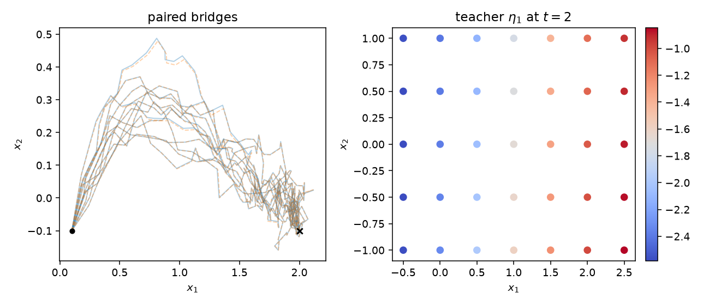

# Day 20 — Howard, Nüsken & Pidstrigach (2026) Control Consistency Diffusion Bridges

- Date: 2026-11-12（Asia/Tokyo）
- Paper: Samuel Howard, Nikolas Nüsken, Jakiw Pidstrigach,
  *Control Consistency Losses for Diffusion Bridges*.
- 採録先と年: **ICML 2026**（第 43 回 International Conference on Machine Learning、査読付き、PMLR 306:44330–44367）。preprint ではない。
  https://proceedings.mlr.press/v306/howard26b.html
  PDF: https://raw.githubusercontent.com/mlresearch/v306/main/assets/howard26b/howard26b.pdf
  arXiv: https://arxiv.org/abs/2512.05070
  Code: https://github.com/samuel-howard/control_consistency_bridges
- 成果物: config `configs/daily_neural_sde_day20.json` /
  コード `src/daily_neural_sde/day20_howard_ccdb.py` /
  数値 `outputs/daily_neural_sde/day20/results.json`、
  teacher 重み `teacher_ccdb_weights.json`、
  symbolic モデル `symbolic_eta1.json` / `symbolic_eta2.json` / `symbolic_diffusion.json` /
  `symbolic_pure1.json` / `symbolic_pure2.json`、
  TeX `symbolic_sde.tex`（このフォルダにも同じ式）、
  経路図 `drift_grid.png`、
  tests `tests/test_daily_neural_sde_day20.py`（8 tests）。
- 実行: `python3 -m src.daily_neural_sde.day20_howard_ccdb`
  （seed 20、Python 3.12.3、PyTorch 2.15.0+cpu、NumPy 2.5.4、CUDA なし、8.7 秒）。
  実行時の query は train 3840、validation 1280、test 1280 行で、各行は \((t,x_1,x_2)\)。
  \(\eta\) は各行で \((2,)\)。
  `results.json` の `git_head` は実行時点の親 `e98d907` である。

この座標は、Wang et al. (2011) の細胞分化モデルの 2 成分である。遺伝子規制の式ではない。
推定式は teacher の多項式近似であって、Doob の \(h\) 変換の発見ではない。
ニューラルネットワークなのは橋の補正 \(\eta=\nabla\psi\) だけである。参照ドリフト \(b\) と拡散係数 \(\sigma=0.1\) は閉じた形である。

## 0. 前日までの反省の適用

実行前に config へ入れた。test のあとでしきい値は動かしていない。
勾配クリップ 100 だけは、公式実行の前に、同じアーキテクチャの未学習 1 步の勾配ノルム 50.3 を見て置いた。クリップ 1 では零初期の頭部が動かない。test の数値は見ていない。

1. **蒸留の pass の横に oracle 天井を置く (Day 19、Day 10)**。teacher への次数 3・しきい値 0 を test で 1 回だけ当てた。選択には使わない。
2. **定数予測フロアを併記する (Day 19、Day 5)**。フロアは train query の平均を test に置いた NRMSE である。
3. **値の NRMSE の横に微分診断を置く (Day 18)**。H9 は格子上の有限差分 curl である。\(\eta=\nabla\psi\) なので teacher の curl は構成上 0 に近い。
4. **時間と状態の共線性には格子を置く (Day 2)**。選択は軌道 query だけである。格子は選択に入れない。
5. **経路の合格を場の回復と読まない (Day 11、Day 16)**。H4 の経路 RMSE と H6 の格子 NRMSE は別のゲートである。
6. **VIF ゲートは選択されうる最大次数に置く (Day 7、Day 17)**。ゲートは次数 3、定数列を除く、しきい値 10。10 以下でも閉じた形としては読まない。
7. **法則指標にはモンテカルロフロアを置く (Day 10、Day 16)**。フロアが 0.15 を超えたら H5 は不定である。
8. **失敗クラスを分ける (Day 4)**。`non_finite`、`outside_radius`、`nonpositive_diffusion`。半径 8 は数値ガードであり、論文の境界ではない。
9. **1 步の情報量を記録する (Day 16、Day 17)**。\(\|f\|\Delta t/(\sigma\sqrt{\Delta t})\) を `step_ratio` として残す。ゲートにはしていない。

## 1. 論文要約

### 1.1 問題と提案

条件付き拡散、とくに希少な終端条件への拡散橋を、制御付き SDE として学ぶ。
参照過程は

$$
dX_t = b(t,X_t)\,dt + \sigma(t,X_t)\,dB_t.
$$

終端を \(X_T=x_T\) に条件付ける制御 \(u^\star\) は Doob の \(h\) 変換である。
制御付き過程は

$$
dX_t^u = \big(b+(\sigma\sigma^\top)u\big)(t,X_t^u)\,dt + \sigma(t,X_t^u)\,dB_t.
$$

論文は、この制御が解軌道に沿う自己整合（Theorem 2.1 の (SC1)、および Jacobian を抑える Theorem 4.1 の (4.1)）を満たすことを使い、シミュレーションを逆伝播しない固定点損失で \(u_\theta\) を回帰する（式 (12)、式 (49)、Algorithm 1）。
平均スケジュールは、残りの時間にわたる一様な平均である。
ドリフトのパラメータ化は、ブラウン橋の誘導項とニューラルな補正である（式 (16)、Appendix B.1）。
参照ドリフトが勾配形でないときは \(b\) を式の中に残す。

$$
f_\theta(t,X_t) = b(X_t) + \frac{x_T-X_t}{T-t} + \sigma\,\eta_\theta(t,X_t).
$$

\(\eta_\theta=\nabla\psi_\theta\) と置くと、補正は勾配形になる。拡散が状態に依らないとき、制御は \(u=(f-b)/\sigma^2\) である。
最後の離散步は \(x_T\) へ跳ぶ。そのジャンプが終端の制御を決め、自己整合がそれを過去へ運ぶ。

### 1.2 実験と選定理由

Appendix E.4 の通常事象は、Wang et al. (2011) の 2 次元細胞分化モデルである。
\(\sigma=0.1\)、\(T=4\)、\(x_0=(0.1,-0.1)\)、\(x_T=(2.0,-0.1)\)。
論文の Table 1 では、この通常事象の \(\mathrm{KL}(\mathbb{P}^\theta\|\mathbb{P})\) が (SC1) も (4.1) も 6.53 である。
論文は 500 步、各步 64 本、1000 回更新、学習率 \(10^{-3}\) を使う。

Day 14 はオフライン制御の距離依存拡散、Day 17 は CIR 強度、Day 2 は OU の GAN であった。
本日は、閉じた参照ドリフトの上に乗る時間依存の橋補正を選んだ。
採録は ICML 2026 である。
OU、CIR、二重井戸、Müller–Brown、希少事象、多峰、化学の橋は範囲外である。

## 2. データと Neural SDE の入手・再構成

### 2.1 データと teacher

潜在の参照 SDE は Appendix E.4 の通常事象のままである。

$$
\begin{aligned}
b_1(x) &= \frac{x_1^4}{2^{-4}+x_1^4}+\frac{2^{-4}}{2^{-4}+x_2^4}-x_1,\\
b_2(x) &= \frac{x_2^4}{2^{-4}+x_2^4}+\frac{2^{-4}}{2^{-4}+x_1^4}-x_2.
\end{aligned}
$$

\(2^{-4}=0.0625\)。\((1,1)\) では \(b=0\)、\((0,0)\) では \(b=(1,1)\) である。
拡散は対角で、両成分が定数 \(0.1\) である。ネットワークではない。

teacher は幅 32、深さ 2、SiLU のポテンシャルである。
時間は \(t/T\) と、周波数 \(1,\ldots,4\) の正弦と余弦である。この埋め込みは teacher の内部にだけあり、SINDy のライブラリには入れない。
状態勾配 \(\eta=\nabla_x\psi\) がニューラルな補正である。頭部は 0 で初期化するので、初期ドリフトは \(b\) と橋の誘導項だけである。
学習は (4.1) の平均スケジュールである。軌道は stop-gradient で進め、損失は制御 \(u\) と逆向きターゲットの二乗である。
步数 40、更新 180、バッチ 16、Adam、学習率 \(10^{-3}\)、勾配クリップ 100。
検証損失では止めない。訓練損失は 802.3 から 202.2 へ下がった。生存数の最小は 16/16 である。
損失 202 は制御残差の二乗平均で、Doob 制御への収束を意味しない。
真の橋との KL は計算していない。Table 1 の 6.53 は再現対象にしていない。

蒸留の query は、学習とは別の seed で teacher から生成した橋である。
有限な軌道は 208 本、棄却は 0 本であった。
その順に train 96、validation 32、test 32 を取り、各軌道の内部時刻 \(0,\Delta t,\ldots,T-\Delta t\) を 1 行にする。
終端のジャンプ点は \(t=T\) で誘導項が定義されないので query に入れない。
teacher の学習ノイズはこの分割を見ない。

### 2.2 逸脱の明示

1. 論文は 500 步と 1000 更新とバッチ 64 である。本日は 40 步、180 更新、バッチ 16 である。\(\Delta t=0.1\)。
2. 論文の \(\psi\) は De Bortoli et al. (2021) の時間埋め込みで、幅 \([128,128]\)、時間側 \([64,64]\) である。本日は幅 32、深さ 2、周波数 4 の正弦埋め込みである。
3. 頭部の零初期化と勾配クリップ 100 は論文の細胞実験には書かれていない。クリップは未学習 1 步の勾配ノルム 50.3 に対して、初期步では拘束しない値にした。
4. 実装は JAX ではなく PyTorch の float64、CPU である。
5. 自己整合は (4.1)、スケジュールは平均である。これは Table 1 の 2 行のうちの 1 行で、通常事象ではもう 1 行と同じ 6.53 が報告されている。
6. 稀事象、多峰、OU、CIR、Müller–Brown、化学ポテンシャル、NGDB、SDB、FB、BEL との比較は範囲外である。
7. ライブラリは \((t,x_1,x_2)\) の冪だけである。正弦、Hill 分数、\(1/(T-t)\) は入れない。
8. 半径 8 は数値ガードである。最後の步は論文どおり決定的なジャンプで、その步のブラウン増分は使わない。

## 3. 仮説（config に事前凍結）

しきい値は、状態の移動量約 1.9、\(\sigma=0.1\)、\(T=4\)、および前日までのゲート 0.25 と VIF 10 から置いた。
teacher の fit も test 軌道も、この数値には入っていない。
test のあとでしきい値は動かしていない。

- **H1** (\(\eta\) の両成分): symbolic 対 teacher の test NRMSE \(\le 0.25\)、かつ train 平均の定数予測フロアより小さい。pass は Doob 制御ではない。次数 3・しきい値 0 の天井と一致した pass は疎な回復ではない。
- **H2** (拡散): 多項式対定数 \(0.1\) の test NRMSE \(\le 0.05\)、かつ非正の割合 \(\le 0.02\)。拡散はネットワークではない。このゲートは、冪ライブラリが状態依存の拡散を発明しないことの確認である。
- **H3**: 次数 3 の VIF（定数列を除く）が 10 を超えたら不定。10 以下でも閉じた形としては読まない。
- **H4**: test と同じ初期状態と共有ノイズ、40 步、終端ジャンプ。失敗率は teacher も symbolic も \(\le 0.05\)、差 \(\le 0.02\)。外れたら不定。内側のとき、全時点の経路 RMSE \(\le 0.25\) かつジャンプ直前の RMSE \(\le 0.30\)。
- **H5**: 新しい 64 本。平均経路 RMSE は symbolic 対 teacher \(\le 0.15\)。teacher 対 teacher のフロアが 0.15 を超えたら不定。失敗率 \(\le 0.05\)。
- **H6**: 格子は \(t\in\{0,1,2,3,3.8\}\)、\(x_1\in[-0.5,2.5]\)、\(x_2\in[-1,1]\)。symbolic 対 teacher の NRMSE \(\le 0.60\)。時刻反転 \(t\mapsto (T-\Delta t)-t\) の相対 RMS は teacher \(\ge 0.10\)、teacher と symbolic の差 \(\le 0.25\)。格子の残差 RMS が軌道上の 5 倍を超えたら増幅として記録する。格子は次数の選択に使わない。
- **H7**: test 上の \(\|\eta\|\) の RMS \(\ge 0.5\)。\(\eta=0\) の誘導付き参照ドリフトと teacher の、同じノイズの経路 RMSE \(\ge 0.04\)。
- **H8**: 制御ドリフト全体への別の SINDy。検証だけで次数としきい値を選ぶ。test NRMSE が、\(b\) と橋の誘導項を残した構造付きドリフトより \(0.10\) 以上悪い。
- **H9**: 格子の有限差分 curl。teacher の RMS \(\le 0.001\)。symbolic の RMS を格子上の \(\|\eta\|\) の RMS で割った比 \(\le 0.25\)。刻みは \(10^{-4}\)。

## 4. 方法

teacher の \(\eta\) への直接 query。特徴は \((t,x_1,x_2)\)。
SINDy の標準化は train query だけから取る。
次数 \(\{1,2,3\}\)、しきい値 \(\{0, 0.02, 0.05, 0.1, 0.2, 0.35\}\)、ridge \(10^{-4}\)。
検証 NRMSE の最小。同点は小さい次数、その次に小さいしきい値。
成分ごとに別々に選ぶ。test はこの選択のあと 1 回。

選択結果: \(\eta_1\) は次数 3・しきい値 0（活性 20、検証 0.06459）。
次数 2・しきい値 0 は検証 0.0922 である。
\(\eta_2\) は次数 3・しきい値 0.02（活性 18、検証 0.1934）。
同じ次数のしきい値 0 は検証 0.1936 で、差は \(1.4\times 10^{-4}\) である。
拡散は次数 1・しきい値 0 である。検証 NRMSE は \(7.3\times 10^{-15}\) で、次数を上げても同点なので最小次数が残る。
純多項式のドリフトは、第 1 成分が次数 3・しきい値 0.02（検証 0.0966）、第 2 成分が次数 2・しきい値 0（検証 0.274）である。
この純多項式は主モデルの選択に使わない。

診断として、teacher への次数 3・しきい値 0 を test で 1 回評価した。
train 行の復元抽出 8 回で、選ばれた次数としきい値の項の出現率を数えた。選択には使わない。
シミュレーションは失敗をラッチし、クラスを分ける。

## 5. 結果

### 5.1 仮説の成否一覧

| 仮説 | 指標 | 値 | しきい値 | 判定 |
|---|---|---|---|---|
| H1 | \(\eta_1\) / \(\eta_2\) の symbolic 対 teacher | 0.0549 / 0.185 | \(\le 0.25\) | **pass** |
| H1 フロア | 定数予測、\(\eta_1\) / \(\eta_2\) | 0.535 / 0.798 | これより小さい | 両方とも下 |
| H1 残差 RMS | symbolic 対 teacher、\(\eta_1\) / \(\eta_2\) | 0.119 / 0.0304 | （併記） | teacher RMS は 2.159 / 0.164 |
| H1 天井 | 次数 3・しきい値 0、\(\eta_1\) / \(\eta_2\) | 0.0549 / 0.1855 | （診断） | \(\eta_1\) はこの天井と一致する |
| H2 | 拡散の NRMSE / 非正の割合 / 平均 | \(7.37\times 10^{-15}\) / 0 / 0.100 | \(\le 0.05\)、\(\le 0.02\) | **pass** |
| H3 | 次数 3 の VIF、定数列を除く | \(3.78\times 10^{4}\) | \(\le 10\) | **不定** |
| H3 条件 | 階数 / 条件数 | 20 / 711 | （併記） | 満階でも係数は分離できない |
| H3 相関 | \(t\) と \(x_1\) / \(t\) と \(x_2\) | 0.929 / \(-0.625\) | （併記） | 橋の上では \(t\) と \(x_1\) が並ぶ |
| H4 失敗 | teacher / symbolic / 純多項式 / \(\eta=0\) | 0 / 0 / 0 / 0 | \(\le 0.05\)、差 \(\le 0.02\) | 内側。H4 は採点された |
| H4 経路 | symbolic 対 teacher / ジャンプ直前 | 0.00261 / 0.000548 | \(\le 0.25\) / \(\le 0.30\) | **pass**。保持割合は 1 |
| H5 平均経路 | symbolic / teacher 対 teacher のフロア | 0.00905 / 0.00919 | \(\le 0.15\) / フロア \(\le 0.15\) | **pass**。誤差はフロア上にある |
| H5 失敗 | teacher / symbolic / フロア用 teacher | 0 / 0 / 0 | \(\le 0.05\) | 内側 |
| H6 格子 | symbolic 対 teacher | 20.4 | \(\le 0.60\) | 外 |
| H6 時刻 | teacher / symbolic の相対 RMS | 0.595 / 11.38 | teacher \(\ge 0.10\)、差 \(\le 0.25\) | 差が外。H6 は **fail** |
| H6 増幅 | 格子 RMS / 軌道上の残差 RMS | 33.05 / 0.0865 | 5 倍 | 比 382。`H6_amplified` は真 |
| H7 | \(\|\eta\|\) の RMS / \(\eta=0\) の経路 RMSE | 1.531 / 0.134 | \(\ge 0.5\) / \(\ge 0.04\) | **pass** |
| H8 | 純多項式 / 構造付き / 差 | 0.139 / 0.0181 / 0.121 | 差 \(\ge 0.10\) | **pass** |
| H8 前半 | \(t\le 2\) の純多項式 / 構造付き | 0.103 / 0.0152 | （併記、ゲートではない） | 同じ 0.10 なら届かない |
| H9 | teacher の curl RMS / symbolic の相対 curl | \(1.44\times 10^{-10}\) / 13.18 | \(\le 0.001\) / \(\le 0.25\) | **fail** |

\(\eta\) のベクトル RMS は test で 1.531 である。
ステップ比は 1.79 である。1 步のドリフト増分は拡散増分より大きく、Day 16 の盲領域（比 0.08）には入っていない。
それでも経路 RMSE 0.00261 と格子 NRMSE 20.4 は両立する。
終端ジャンプと橋の誘導項が経路を終端へ固定し、\(\eta\) の誤差 \(\sigma\times 0.0865\) は経路尺度では小さい。
H4 と H5 の pass は、この固定の上での teacher への近さである。
H5 の 0.00905 はフロア 0.00919 と同じ桁で、ゲート 0.15 はそのフロアの約 16 倍である。
平均経路がフロアより良いという読みはしない。

\(\eta_1\) の test NRMSE 0.0549 は次数 3・しきい値 0 の天井と一致する。
活性は 20 で、ライブラリ 20 項の全部である。
復元抽出 8 回でも 20 項すべてが毎回残る。
これは疎な式ではない。
\(\eta_2\) は検証でしきい値 0.02 がしきい値 0 を \(1.4\times 10^{-4}\) だけ下回った。
test では 0.1850 対天井 0.1855 で、差は \(4.3\times 10^{-4}\) である。
落ちた項の出現率は、\(x_2^2\) が 0.25、\(t^2 x_1\) が 0.625、\(x_2^3\) が 0 である。
それ以外は 1 である。
H3 は不定なので、下の係数は閉じた形ではない。

### 5.2 推定した symbolic SDE

標準化座標から元の \((t,x_1,x_2)\) へ展開した式は `symbolic_sde.tex` と一致する。
これは teacher の多項式近似であり、Doob 制御ではない。
H3 は不定である。条件数 711 の満階ライブラリでも、VIF \(3.78\times 10^{4}\) では係数は分離できない。
\(t\) と \(x_1\) の相関 0.929 は、通常の橋が \(x_1\) を 0.1 から 2 へ運ぶことから来る。
\(\eta_1\) の \(t x_1\) の係数 23.04 や \(x_1^2\) の係数 \(-16.39\) は、その多様体上の打ち消しである。

構造付きの推定 SDE は、論文の \(b\) と橋の誘導項を残し、ニューラルな \(\eta\) だけを多項式で置き換える。
拡散の展開は定数 \(0.1\) である。
標準化座標では次数 1 の 4 係数が非零と数えるが、\(t,x_1,x_2\) の係数は \(10^{-16}\) 未満で、展開のしきい値 \(10^{-12}\) では消える。

$$
\begin{aligned}
dX_t &= b(X_t)\,dt + \frac{x_T-X_t}{4-t}\,dt + 0.1\,\hat\eta(t,X_t)\,dt + 0.1\,dW_t,\\
b_1(x) &= \frac{x_1^4}{0.0625+x_1^4}+\frac{0.0625}{0.0625+x_2^4}-x_1,\\
b_2(x) &= \frac{x_2^4}{0.0625+x_2^4}+\frac{0.0625}{0.0625+x_1^4}-x_2,\\
x_T &= (2,-0.1).
\end{aligned}
$$

$$
\begin{aligned}
\hat\eta_1(t,x_1,x_2) &= -3.888 + 4.112\,x_2 + 7.739\,x_1 - 8.726\,t - 2.255\,x_2^2 - 8.699\,x_1 x_2 \\
&\quad - 16.39\,x_1^2 + 1.965\,t x_2 + 23.04\,t x_1 - 4.395\,t^2 + 0.2895\,x_2^3 - 2.718\,x_1 x_2^2 \\
&\quad + 5\,x_1^2 x_2 + 6.922\,x_1^3 + 3.889\,t x_2^2 - 3.141\,t x_1 x_2 - 9.834\,t x_1^2 \\
&\quad + 0.7429\,t^2 x_2 + 2.483\,t^2 x_1 - 0.05197\,t^3,\\
\hat\eta_2(t,x_1,x_2) &= -0.3154 - 0.5119\,x_2 - 0.07653\,x_1 + 2.017\,t + 1.124\,x_2^2 + 4.287\,x_1 x_2 \\
&\quad + 1.392\,x_1^2 - 3.394\,t x_2 - 3.968\,t x_1 + 0.7542\,t^2 - 2.002\,x_1 x_2^2 \\
&\quad - 2.424\,x_1^2 x_2 - 0.6246\,x_1^3 + 0.8734\,t x_2^2 + 2.26\,t x_1 x_2 + 1.493\,t x_1^2 \\
&\quad - 0.1726\,t^2 x_2 - 0.3776\,t^2 x_1 - 0.00628\,t^3.
\end{aligned}
$$

\(\hat\eta_2\) に \(x_2^3\) はない。出現率 0 の項である。
H9 が落ちたので、この \(\hat\eta\) は勾配場ではない。
格子上の curl の RMS は 21.4 で、teacher の \(\|\eta\|\) の RMS に対する比は 13.2 である。
teacher の同じ差分 curl は \(1.44\times 10^{-10}\) である。

冪だけで制御ドリフト全体を置き換えた式は、主モデルではない。
H8 の差 0.121 はこの式の test NRMSE 0.139 から構造付きドリフトの 0.0181 を引いた値である。
\(t\le 2\) では差が 0.087 まで縮む。
同じノイズでの失敗率は 0 であった。軌道上では発散せず、格子上の \(\eta\) の方が壊れる。

$$
\begin{aligned}
\hat f^{\mathrm{poly}}_1(t,x_1,x_2) &= 0.8338 - 1.72\,x_2 + 0.1338\,x_1 + 0.864\,t + 3.116\,x_2^2 + 6.528\,x_1 x_2 \\
&\quad + 1.867\,x_1^2 - 3.189\,t x_2 - 4.858\,t x_1 + 1.888\,t^2 - 6.139\,x_2^3 - 4.779\,x_1 x_2^2 \\
&\quad - 3.811\,x_1^2 x_2 - 1.867\,x_1^3 + 2.044\,t x_2^2 + 2.729\,t x_1 x_2 + 3.944\,t x_1^2 \\
&\quad - 0.3035\,t^2 x_2 - 2.173\,t^2 x_1 + 0.2828\,t^3,\\
\hat f^{\mathrm{poly}}_2(t,x_1,x_2) &= 1.296 - 1.234\,x_2 - 2.773\,x_1 + 0.9237\,t + 0.8759\,x_2^2 \\
&\quad + 1.271\,x_1 x_2 + 1.069\,x_1^2 - 1.205\,t x_2 - 0.3723\,t x_1 - 0.07095\,t^2.
\end{aligned}
$$

## 6. 考察

軌道上では、次数 3 の多項式が teacher の \(\eta\) に届く。
\(\eta_1\) は天井そのもので、\(\eta_2\) も天井との差が \(4.3\times 10^{-4}\) である。
定数フロア 0.535 と 0.798 よりは小さいので、平均への退化ではない。
しかし同じ式は格子で NRMSE 20.4 まで増え、時刻を反転すると相対 RMS が 0.595 から 11.4 へ壊れる。
curl の比 13.2 は、値の NRMSE 0.0549 が局所的な勾配構造を保っていないことを示す。
経路 RMSE 0.00261 は、この失敗と矛盾しない。
橋の誘導項と終端ジャンプが終端を合わせ、\(\eta\) の寄与は \(\sigma=0.1\) で縮小される。
\(\eta=0\) の経路 RMSE 0.134 は、補正自体は経路を動かしていることを示す。
動かしている項の多項式は、橋の外では teacher ではない。

VIF \(3.78\times 10^{4}\) は、満階で条件数 711 でも、橋の上の \(t\) と \(x_1\) が係数を分けないことを示す。
表示した 23.04 や \(-16.39\) を Hill 関数や \(1/(T-t)\) の展開として読まない。

H8 の pass は狭い。
全時刻の差 0.121 はゲート 0.10 のすぐ上で、\(t\le 2\) では 0.087 である。
純多項式は、この橋の上では誘導項の大きな値を時刻の多項式である程度追える。
それは \(1/(T-t)\) をライブラリが持ったということではない。

teacher 自身も、自己整合損失 202 で止まっている。
180 更新は論文の 1000 更新より短く、真の橋との KL は測っていない。
H1 の pass は、この未収束の teacher への近似である。

## 7. 反省

軌道上の \(\eta\) NRMSE が 0.0549 と 0.185 でゲート 0.25 の内側でも、格子 NRMSE は 20.4、時刻反転の相対 RMS は teacher 0.595 に対し多項式 11.4、curl の相対 RMS は 13.2 である。
VIF は \(3.78\times 10^{4}\) で、\(t\) と \(x_1\) の相関は 0.929 である。
終端ジャンプのある経路 RMSE 0.00261 は、平均経路フロア 0.00919 の横に置いても、格子と curl の回復ではない。
\(\eta_1\) の pass は次数 3・しきい値 0 の天井そのものである。
翌日は、終端へ固定する誘導項があるとき、経路 RMSE の pass を場の pass と分け、格子と curl を同じ表に残す。
